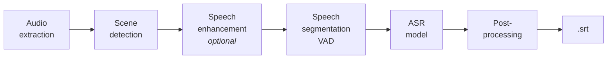

# WhisperJAV

<p align="center">
  <a href="https://colab.research.google.com/github/meizhong986/WhisperJAV/blob/main/notebook/WhisperJAV_colab_edition_expert.ipynb">
    
  </a>
  <a href="https://kaggle.com/kernels/welcome?src=https://github.com/meizhong986/WhisperJAV/blob/main/notebook/WhisperJAV_kaggle_parallel_edition.ipynb">
    
  </a>
  <a href="https://buymeacoffee.com/meizhong">
    
  </a>
</p>

A subtitle generator for Japanese Adult Videos. Free, runs on your own machine, no cloud upload of your media.

**Documentation:** [English](https://meizhong986.github.io/WhisperJAV/) | [简体中文](https://meizhong986.github.io/WhisperJAV/zh/)

---

## The idea

Speech recognition models like Whisper are trained on clean, curated speech. JAV audio is the opposite of that, and the mismatch breaks them in specific, well-understood ways:

1. **The acoustic profile.** JAV audio has a low signal-to-noise ratio and a high density of non-verbal vocalisations — breathing, gasps, moans — whose spectra often mimic real Japanese syllables (e.g. *fu*), tricking the model into hearing words where none exist. Add extreme volume swings (whispers to screams) and theatrical role language (*yakuwarigo*) absent from training corpora, and the model's assumptions stop holding.

2. **Long-form drift and hallucination.** These are feature-length recordings, not 30-second clips. Over long stretches of ambiguous audio — silence, rhythmic breathing — the model's attention collapses and it fills the void with repeated or invented text. This is a documented failure mode of Whisper-family models [3, 4, 5].

3. **The pre-processing paradox.** Intuition says "denoise first". In practice, blanket denoising and vocal isolation can strip the high-frequency detail the model needs to tell consonants apart, making things worse. Fine-tuning on JAV data has its own trap: good datasets are scarce, so fine-tuned models tend to overfit and become hit-or-miss.

WhisperJAV is built around these three failure points rather than around any single model:

- **Scene-based segmentation** — split the audio at natural acoustic boundaries so the model always processes a coherent environment, never a mixed stream [1, 2].
- **VAD clamping** — detect where speech actually is, and feed the model only that, with measured padding. This is the main defence against hallucination on non-speech.
- **Defensive decoding and post-processing** — tuned confidence thresholds discard low-quality output, and Japanese-aware filters clean what remains.

None of this is magic; it is careful plumbing around known model weaknesses, and the defaults are tuned against ground-truth benchmarks. Results still vary with source audio quality.

---

## Quick start

**GUI** (recommended): launch **WhisperJAV** from the desktop shortcut (Windows installer) or run:

```bash
whisperjav-gui
```

Add files, pick a mode, click Start. Subtitles land next to your video as `.srt`.

**Command line:**

```bash
whisperjav video.mp4                                        # defaults
whisperjav video.mp4 --mode balanced --sensitivity aggressive
whisperjav /path/to/folder --output-dir ./subtitles         # whole folder
```

Any input FFmpeg can read works: MP4, MKV, AVI, WMV, MP3, WAV, FLAC, and so on. Output is SRT (default), WebVTT, or both (`--output-format both`).

---

## How a video becomes subtitles

Every pipeline follows the same overall shape; modes differ in which components they use and how aggressively they are tuned.



- **Scene detection** uses the media characteristics to cut by predicted scenes. This allows the downstream VAD and ASR to receive chunks which have similar DNA.
- **Speech enhancement** (off by default) can clean audio per-scene — used surgically, per the pre-processing paradox above. 
- **Speech segmentation (VAD)** finds where speech actually is inside each scene. This choice matters more than most settings: it decides what the model hears and, in the modern pipelines, where your subtitle timestamps come from.
- **The ASR model** turns speech into text.
- **Post-processing** is the Japanese-specific cleanup pass:
  - Sentence regrouping aware of ending particles (ね, よ, わ, の), aizuchi (うん, はい), and dialect patterns (Kansai-ben and others)
  - Hallucination and repetition removal
  - Sound-only line removal — subtitle lines that are purely moans/breathing kana are dropped (real dialogue is protected by an evidence check)
  - Timing repair — a subtitle whose duration is absurdly long for its text gets its start pulled in (the end stays put); the console reports how many lines were retimed
  - Scene-boundary overlap resolution

Each stage has several interchangeable providers — the full menu, with strengths and weaknesses, is in [Mix-and-match strategies](#mix-and-match-strategies) below.

---

## Processing modes

| Mode | Engine | Character |
|---|---|---|
| **balanced** | Faster-Whisper | Default. Full pipeline; good speed/accuracy balance |
| **fidelity** | OpenAI Whisper | Slowest, most thorough of the classic pipelines |
| **fast** | OpenAI Whisper + scene detection | General use, mixed-quality audio |
| **faster** | Faster-Whisper, minimal preprocessing | Speed first, clean audio |
| **qwen** (ChronosJAV) | Qwen3-ASR | Modern text-first recognizer |
| **anime-whisper** (ChronosJAV) | anime-whisper | Anime/JAV-tuned dialogue |
| **transformers** | HuggingFace | Kotoba and other HF Whisper models |
| **parakeet**, **cohere**, **reazonspeech**, **kotoba**, **whisper-turbo**, **whisper-large**, **MOSS** (`*-crispasr`, Ensemble passes) | CrispASR (GGUF models) | Japanese; experimental (parakeet and cohere since 1.10.0, the others new in 1.10.1) |

**Sensitivity** applies to every mode: **conservative** (fewer false positives, good for noisy content) · **balanced** · **aggressive** (catches more quiet dialogue; good for whisper/ASMR content — and the tuning target of most of our benchmark work).

### ChronosJAV

Some of the best ASR models for this material (anime-whisper, Qwen3-ASR and its Japanese fine-tunes) do not give reliable times on their own. ChronosJAV therefore takes the text from the ASR model and the times from a separate step. By default each subtitle takes the start and end of the piece of speech (VAD group) the speech segmenter found, and no aligner is loaded — as in 1.9.x, and again since 1.10.1 (1.10.0 timed the text with an aligner and a timing model by default). Both remain choices in the settings: an aligner mode (CrispASR's aligners such as `wav2vec2-ja`, or the PyTorch Qwen3 forced aligner) and the Whisper small timing model.

The same decoupled design is why new models can be added without rebuilding the pipeline — anything that turns audio into text can be slotted in.

---

## Two-pass ensemble

Different pipelines miss different lines. Ensemble mode runs your file through two pipelines and merges the results.

**The v1.9.5 default pairing:** pass 1 = **Qwen3-ASR** with FireRedVAD, pass 2 = **anime-whisper** with TEN VAD, both on Aggressive — two different recognizers *and* two different VADs, so their blind spots don't overlap. In the GUI, pass 2 runs once you tick it.

```bash
whisperjav video.mp4 --ensemble \
    --pass1-pipeline qwen --pass2-pipeline balanced \
    --merge-strategy pass1_primary
```

- **Merge strategies:** `pass1_primary` / `pass2_primary` (one pass leads, the other fills gaps), `smart_merge`, `full_merge`, `pass1_overlap` / `pass2_overlap`, `longest`
- **Presets:** save and reload named ensemble configurations from the GUI
- **Serial mode** ("Finish each file", `--ensemble-serial`, on by default since 1.10.1; `--no-ensemble-serial` turns it off): finish each file completely before starting the next, so results appear as they're done
- **Bring your own pass 1, pass 2 or both:** [PurfView's Faster-Whisper XXL](https://github.com/Purfview/whisper-standalone-win) (`--pass1-pipeline xxl` and/or `--pass2-pipeline xxl`, with `--xxl-exe ...`; the model with `--pass1-model` / `--pass2-model`, default `large-v2`)

---

## Mix-and-match strategies

The Ensemble tab is a mixing desk. Each pass is a free combination of five choices — **pipeline × scene detection × audio pre-processing × speech segmentation × ASR model** — and the two-pass design is the sixth dimension. The defaults are benchmark-tuned, so you never *have* to touch any of this; but audio varies a lot, and one deliberate substitution is often worth the experiment. The golden rule: **change one thing at a time**, so you know what caused the difference.

### Pipeline

The recipe that ties the other choices together.

| Pipeline | Strength | Watch out |
|---|---|---|
| **balanced** | The workhorse: full pipeline, good speed/accuracy, every component swappable | Jack of all trades — specialists beat it on their home turf |
| **fidelity** | Most thorough classic pipeline; strong on quiet/ASMR content | Slowest option |
| **fast** | Decent middle ground on mixed-quality audio | Fewer defences than balanced |
| **faster** | Speed; fine for clean, dialogue-forward audio | Minimal preprocessing = less hallucination protection |
| **qwen** (ChronosJAV) | Modern text-first recognizer; robust on messy audio | Timestamps come from the VAD, so the segmenter choice matters doubly |
| **anime-whisper** (ChronosJAV) | Best-in-class on anime-style/JAV dialogue; heavily benchmark-tuned here | Can miss very faint, isolated utterances |
| **transformers** | Runs any HF Whisper model; best GPU path on Apple Silicon | Uses HF's own chunking — scene/segmenter choices don't apply |
| **The seven GGUF pipelines** (`*-crispasr`) | GGUF models through CrispASR, installed with WhisperJAV; scene detection, enhancement and VAD work as for the other passes | Experimental; Japanese only |
| **xxl** | Bring your own external engine as a pass | Self-contained: WhisperJAV's knobs don't reach inside |

> **Naming note (CLI users).** *ChronosJAV* is one pipeline with interchangeable recognizers, so **qwen** and **anime-whisper** are two backends of it rather than two separate pipelines. The GUI lists them side by side in the pipeline dropdown; on the command line both live under `qwen`, and the backend is chosen inside the params:
>
> ```bash
> # Qwen3-ASR (the default backend)
> --pass1-pipeline qwen
>
> # anime-whisper, same pipeline, different recognizer
> --pass1-pipeline qwen --pass1-qwen-params '{"generator_backend": "anime-whisper"}'
> ```
>
> The usable values for `generator_backend` are `qwen3` and `anime-whisper` (a third, `cohere`, exists in the code but is not currently enabled). Note also that `litagin/anime-whisper` can be loaded through the **transformers** pipeline via `--hf-model-id` — but that route uses HF's own chunking and does not produce usable per-line timing, so prefer the ChronosJAV route above.

### Scene detection

Where the long file gets cut into workable pieces.

| Method | Strength | Watch out |
|---|---|---|
| **Semantic** | Groups acoustically similar audio; best for full-length features. **The default everywhere since v1.9.2** (it was auditok) | Occasionally cuts inside speech on very uniform audio; the flip has not been proven better on a feature-length film |
| **Auditok** | Energy-based: fast, simple, dependable. The pre-1.9.2 default — `--scene-detection-method auditok` | Constant background music can mask the pauses it needs |
| **Silero** | Neural; holds up on noisy audio | Slower than auditok |
| **None** | No cutting at all | Only sensible for short clips |

### Audio pre-processing (speech enhancement)

Off by default — remember the pre-processing paradox. The **"Enhance for VAD only"** checkbox is the safest way to use these: the cleaned audio guides speech detection while the model still hears the original.

| Backend | Strength | Watch out |
|---|---|---|
| **none** | No artefacts, no surprises — the right default | Won't rescue genuinely bad audio |
| **ffmpeg-dsp** | Transparent classic filters (loudnorm, denoise, compress…); loudnorm genuinely helps very quiet recordings | Aggressive settings dull consonants |
| **zipenhancer** | Lightweight neural denoise; good against hiss | 16 kHz processing; can soften detail |
| **htdemucs** | Vocal isolation — separates voice from loud BGM | The biggest intervention of all; reserve for music-dominated content |

### Speech segmentation (VAD)

Decides what the model hears — and in ChronosJAV pipelines, where your timestamps come from. Probably the highest-leverage swap on this list.

> **Not on Balanced, since v1.9.2.** The Balanced pipeline uses Faster-Whisper's own voice detection and accepts **none** of the backends below — `--speech-segmenter` with `--mode balanced` stops the run with an error, as do `--max-group-duration` and `--chunk-threshold`. What you choose there instead is which **Silero build** that detection runs: `--vad-version 3.1 | 4.0 | 6.2` (default **4.0**), or the *Speech Segmenter* column of a Balanced pass in the Ensemble Mode tab. Every other pipeline takes the table below unchanged.

| Backend | Strength | Watch out |
|---|---|---|
| **WhisperSeg** | Trained on Japanese ASMR-style audio; tuned against our ground truth; the JA default | Japanese-specialised — switch it for other languages |
| **TEN VAD** | Light and quick; good general performer; pass-2 default for diversity | Less JA-specialised than WhisperSeg |
| **Silero v3.1 / v4.0** | Solid general-purpose; the recommendation for non-Japanese audio | Tends to miss very quiet Japanese speech |
| **Silero v6.2** | Adds max-duration splitting and finer control | Same quiet-speech caveat |
| **Faster-Whisper native** *(Balanced — and the only option there)* | Fastest — one recognizer call per scene; pick the Silero build with `--vad-version` | Coarser timing than a dedicated VAD; no independent speech detector for the run-outcome check |
| **FireRedVAD** *(Fidelity default)* | Tiny multilingual model, cheap on CPU; lowest false-alarm rate of the bundled VADs; installed with WhisperJAV since v1.9.2 | Its ~2 MB model downloads from Hugging Face once — a machine that cannot reach it stops the run and says so; `--speech-segmenter silero-v3.1` needs no download |
| **None** | The model hears everything | Maximum hallucination exposure on non-speech |

### ASR engine and model

| Model | Pipeline | Strength | Watch out |
|---|---|---|---|
| **Whisper large-v2** | classic | The most predictable performer on this domain — that's why it's the default | Not the newest |
| Whisper large-v3 | classic | Newer training | More hallucination-prone on JAV audio |
| Whisper turbo | classic | Fastest Whisper | Some accuracy cost |
| **whisper-ja-1.5B** (CT2) *(new)* | balanced | JA finetune, word timestamps intact; strongest results in our scene-length benchmarks | Community model; occasional repetitions (our filters catch most) |
| **anime-whisper** | ChronosJAV | Excellent anime/JAV dialogue quality | No native timestamps — VAD-timed |
| **Qwen3-ASR 1.7B / 0.6B** | ChronosJAV | Robust on messy audio; 0.6B fits 4 GB VRAM | No native timestamps — VAD-timed |
| **JA Anime-Galgame 1.7B** *(new)* | ChronosJAV | Qwen finetune with published gains on anime speech (CER −27% rel.); recovers lines the base drops | Slightly more junk insertions (post-processing handles most) |
| **JA-tuned 1.7B (neosophie)** *(new)* | ChronosJAV | Qwen finetune aimed at proper nouns and kanji-heavy phrasing | No published benchmarks |
| **Kotoba family** | transformers | Japanese-optimized, light; bilingual variant; good on Apple Silicon | Smaller models — ceiling below the 1.5B+ class |

### The two-pass dimension

Everything above multiplies: two passes means two full recipes, then a merge. What makes a *good* pair is diversity — different recognizers **and** different VADs, so the passes fail in different places and the merge covers both.

A few known-good recipes:

| Goal | Pass 1 | Pass 2 | Merge |
|---|---|---|---|
| The v1.9.5 default | Qwen3-ASR · semantic · FireRedVAD · aggressive | anime-whisper · semantic · TEN · aggressive | `pass1_primary` |
| Classic + modern | balanced · large-v2 | qwen (or the Anime-Galgame finetune) | `pass1_primary` |
| Quiet/ASMR recall | fidelity · aggressive | anime-whisper · aggressive | `longest` |
| Second opinion on the model only | your usual recipe | same recipe, different ASR model | `pass1_primary` |

**Merge strategies.** Seven are available (`--merge-strategy`):

| Strategy | What it does |
|---|---|
| **`pass1_primary`** | Keeps pass 1 as primary and fills missing parts from pass 2 |
| `pass2_primary` | The mirror image — pass 2 primary, filled from pass 1 |
| `smart_merge` | Automatically picks the better line from each pass |
| `full_merge` | Includes every line from both passes — most recall, most duplicates to clean up |
| `longest` | For each overlapping pair, picks the subtitle with more text content |
| `pass1_overlap` / `pass2_overlap` | Same as the `_primary` pair, but tolerates up to 30% overlap when filling — use when the two passes disagree slightly on boundaries |

Save anything that works as a **preset** so it's one click next time.

---

## AI translation

Generate and translate in one go, or translate subtitles you already have:

```bash
whisperjav video.mp4 --translate                      # transcribe + translate
whisperjav-translate -i subtitles.srt --provider ollama
```

| Provider | Cost | Notes |
|---|---|---|
| **Ollama** | free, local | Recommended local option; auto-starts the server and picks a model for your VRAM |
| DeepSeek | cheap | Good quality/price for this content |
| Gemini | free tier | |
| Claude / GPT / OpenRouter / GLM / Groq | paid API | |

Interrupted translations resume where they left off — just run the same command again.

---

## The GUI

Four tabs:

1. **Transcribe** — files, mode, sensitivity, language
2. **Advanced options** — output format, scene detection, model override, debug
3. **Ensemble** — the two-pass grid: per-pass pipeline, sensitivity, scene detector, enhancer, VAD, and model, plus a Customize dialog exposing each backend's tunable parameters, and preset save/load
4. **AI SRT Translate** — translate existing subtitle files

Sensible defaults everywhere: if you never open a Customize dialog, you get the benchmark-tuned configuration.

---

## Which mode for which content

| Content | Suggestion | Sensitivity |
|---|---|---|
| Dialogue-heavy drama | balanced | aggressive |
| Anime-style / clear JAV dialogue | anime-whisper | aggressive |
| ASMR / whispering / VR | fidelity or anime-whisper | aggressive |
| Heavy background music | balanced | conservative |
| Amateur / variable audio | fast | conservative |
| Group scenes | faster | conservative |
| Best possible result | ensemble (anime-whisper + qwen) | per-pass defaults |

These are starting points, not rules — see [Mix-and-match strategies](#mix-and-match-strategies) for how to adapt them.

---

## Which pipeline for which computer

You choose your kind of computer once, when you install WhisperJAV.

| Your computer | What uses the graphics card |
|---|---|
| NVIDIA graphics card | Every pipeline. |
| AMD or Intel graphics card, or an older NVIDIA card (Windows) | The GGUF pipelines (Ensemble tab, Pipeline menu groups "GGUF via crispasr" and "Experimental, open to feedback"), through Vulkan. Experimental, not yet tested. The other pipelines run on the processor, several times slower. |
| Mac with Apple silicon | transformers asks for the Apple GPU; the GGUF pipelines and fidelity ask for it too (not yet tested on a Mac). balanced, fast, faster and ChronosJAV run on the processor. |
| No graphics card | None: every pipeline runs on the processor, several times slower than on a graphics card. |

---

## Installation

> **Already on 1.10?** Windows installer: close WhisperJAV and run `"%LOCALAPPDATA%\WhisperJAV\python.exe" -m whisperjav.upgrade` in Command Prompt (or your install folder's `python.exe`), not `whisperjav-upgrade`, which can leave an install on another drive than Windows' temporary folder (normally C:) unable to start. It keeps the accelerator of your install. The GUI only tells you that a new version is out. If WhisperJAV no longer starts after an upgrade, uninstall it and install the newest release with the Windows installer; your settings and downloaded models stay. Source install: `git fetch --tags`, `git checkout` the new release tag, and run the installer again with the same Python environment active. **On 1.9.x?** Install 1.10 fresh: it needs Python 3.13, so `whisperjav-upgrade` cannot take 1.9.x to it.
>
> **Each install is made for one accelerator**, chosen when you install: NVIDIA GPU (CUDA), GPU through Vulkan (AMD, Intel or older NVIDIA card, Windows), Apple GPU (Metal), your own PyTorch, or CPU only. See [Accelerated or not](https://meizhong986.github.io/WhisperJAV/getting-started/#accelerated-or-not).

### Windows — standalone installer (recommended)

No Python knowledge needed.

1. Download the `.exe` from [**Releases**](https://github.com/meizhong986/WhisperJAV/releases/latest)
2. Run it — no admin rights required (installs to `%LOCALAPPDATA%\WhisperJAV`)
3. Wait 10–30 minutes while it sets up Python, PyTorch, FFmpeg and dependencies. With a supported NVIDIA GPU (GTX 16 / RTX 20 or newer, driver 580+) it installs for the GPU by itself; otherwise a window asks what the install should be made for
4. Launch from the desktop shortcut. First transcription downloads models (~3 GB)

### Google Colab / Kaggle

Not supported by 1.10, which is made and tested for installs on your own computer only. The Colab expert notebook (badge at the top) keeps installing 1.9.5.

<details>
<summary><b>Windows — install from source</b></summary>

Prerequisites: Python 3.13, Git, FFmpeg in PATH.

```batch
git clone --branch v1.10.1 https://github.com/meizhong986/whisperjav.git
cd whisperjav
installer\install_windows.bat                    :: a supported NVIDIA GPU is used; otherwise it asks
installer\install_windows.bat --accelerator cpu  :: or choose: nvidia, vulkan, own-pytorch, cpu
```

Full guide: [docs/en/guides/installation_windows_python.md](docs/en/guides/installation_windows_python.md)
</details>

<details>
<summary><b>macOS (Apple Silicon)</b></summary>

```bash
xcode-select --install
brew install python@3.13 ffmpeg portaudio git

git clone --branch v1.10.1 https://github.com/meizhong986/whisperjav.git
cd whisperjav
python3.13 -m venv ~/venvs/whisperjav && source ~/venvs/whisperjav/bin/activate
chmod +x installer/install_mac.sh && ./installer/install_mac.sh
```

Apple silicon, macOS 14 or newer; the install is made for the Apple GPU (Metal). The transformers pipeline uses the Apple GPU and is recommended on a Mac; fidelity and the GGUF pipelines ask for it (not yet tested on a Mac); balanced, fast, faster and ChronosJAV run on the CPU. Intel Macs are not supported by 1.10.

Full guide: [docs/en/guides/installation_mac_apple_silicon.md](docs/en/guides/installation_mac_apple_silicon.md)
</details>

<details>
<summary><b>Linux</b></summary>

Install system packages first (Ubuntu example; see the guide for Fedora/Arch):

```bash
sudo apt-get install -y python3 python3-pip python3-venv python3-dev \
    build-essential ffmpeg git libsndfile1 libsndfile1-dev
```

Then:

```bash
git clone --branch v1.10.1 https://github.com/meizhong986/whisperjav.git
cd whisperjav
chmod +x installer/install_linux.sh && ./installer/install_linux.sh
```

Linux with glibc 2.35 or newer (Ubuntu 22.04+, Debian 12+, Fedora 36+) and Python 3.13. For the GPU you need the NVIDIA driver (570+), but not the CUDA Toolkit — PyTorch bundles its own runtime. On distros with externally-managed Python (Ubuntu 24.04+), use a venv; the script detects this and tells you what to do.

The GUI needs a pywebview backend **inside** your environment — the distro's WebKit2GTK packages install system-wide, where a plain virtual environment cannot see them, which is why the GUI can still stop with `ModuleNotFoundError: No module named 'gi'`. Either `pip install "pywebview[qt]"` (the Qt backend, no system GTK bindings needed), or create the venv with `python3 -m venv --system-site-packages` so it can see the distro's bindings.

Full guide: [docs/en/guides/installation_linux.md](docs/en/guides/installation_linux.md)
</details>

<details>
<summary><b>Expert: your own Python environment and PyTorch</b></summary>

Every 1.10 install gets the package versions its release was tested with: `install.py` installs them from the lock file with `uv sync`. To keep a PyTorch build you already have in your environment (for example ROCm for an AMD GPU), install with:

```bash
python install.py --accelerator own-pytorch
```

WhisperJAV then installs everything except PyTorch and never replaces it (experimental).
</details>

### System requirements

| | Minimum | Recommended |
|---|---|---|
| OS | Windows 10 (x86-64) / macOS 14 on Apple silicon / Linux with glibc 2.35 (Ubuntu 22.04) | Windows 11 / macOS 14 or newer / Ubuntu 24.04 |
| Python (source installs) | 3.13 | 3.13 |
| RAM | 8 GB | 16 GB |
| Disk | 8 GB | 15 GB with models |
| GPU | none (CPU works, slowly) | NVIDIA GTX 16 / RTX 20 or newer, or Apple silicon |

Rough speed per hour of video: **RTX GPU** 5–10 min · **Apple Silicon** 8–15 min · **CPU** 30–60 min.

### Without a supported NVIDIA GPU

Choose what the install is made for when you install — GPU through Vulkan (Windows: AMD, Intel or older NVIDIA card; the GGUF pipelines use it, experimental), your own PyTorch, or CPU only. Every run then follows that choice; nothing needs ticking. At the start of each run WhisperJAV says where each part runs. `--device cpu` runs one job on the CPU. Details: [Accelerated or not](https://meizhong986.github.io/WhisperJAV/getting-started/#accelerated-or-not).

---

## Troubleshooting

- **The Windows installer stopped and said the installation failed.** Since v1.9.2 it checks that what WhisperJAV needs to run actually imports, and **stops rather than leaving you a shortcut to a broken install**. It names what failed and writes `INSTALLATION_FAILED_v<version>.txt` next to `install_log_v<version>.txt` in the installation folder. Run the installer again first — the usual cause is a download that did not finish. If it fails twice, attach both files to an issue.
- **"FFmpeg not found"** — install FFmpeg and add it to PATH.
- **Very slow** — run `whisperjav --check`, or read the box at the start of a run: they say where each part runs. On a CPU-only install everything runs on the CPU, several times slower than on a GPU.
- **`model.bin` error in faster mode** — enable Windows Developer Mode (or run once as admin), then delete the cached model folder under `%USERPROFILE%\.cache\huggingface\hub`.
- **An empty or very short subtitle file, with the run reporting success.** v1.9.2 fixes one cause of this on Balanced and now reports the outcome per file rather than always claiming success. If it still happens, that is worth a report.
- Anything else: open a [GitHub issue](https://github.com/meizhong986/WhisperJAV/issues) with your system info and the console log. `tools/whisperjav_env_report.py` in this repository prints your package versions, GPU, driver and CUDA in one go — run it with the same Python that runs WhisperJAV (Windows users can right-click `whisperjav_env_report.ps1`). Logs and reproduction details make fixes much faster.

---

## Contributing

Contributions are welcome — see `CONTRIBUTING.md`. Development setup:

```bash
git clone https://github.com/meizhong986/whisperjav.git
cd whisperjav
pip install -e ".[dev]"
python -m pytest tests/
```

---

## License

MIT. See [LICENSE](LICENSE).

## References

1. Chen, Y., et al. (2025). "ChronusOmni: Improving Time Awareness of Omni Large Language Models." arXiv:2512.09841. *(Inspiration for the ChronosJAV pipeline)*
2. Bain, M., et al. (2023). "WhisperX: Time-Accurate Speech Transcription of Long-Form Audio." arXiv:2303.00747.
3. Wang, Y., et al. (2025). "Calm-Whisper: Reduce Whisper Hallucination On Non-Speech By Calming Crazy Heads Down." Interspeech 2025. arXiv:2505.12969.
4. Barański, M., et al. (2025). "Investigation of Whisper ASR Hallucinations Induced by Non-Speech Audio." arXiv:2501.11378.
5. Koenecke, A., et al. (2024). "Careless Whisper: Speech-to-Text Hallucination Harms." ACM FAccT 2024.
6. Roll, N., et al. (2025). "In-Context Learning Boosts Speech Recognition via Human-like Adaptation to Speakers and Language Varieties." arXiv:2505.14887.
7. Yang, X., et al. (2024). "PromptASR for Contextualized ASR with Controllable Style." ICASSP 2024. arXiv:2309.07414.

## Acknowledgments

Built on the shoulders of: [OpenAI Whisper](https://github.com/openai/whisper) · [faster-whisper](https://github.com/guillaumekln/faster-whisper) · [stable-ts](https://github.com/jianfch/stable-ts) · [Qwen3-ASR](https://github.com/QwenLM/Qwen3-ASR) · [anime-whisper](https://huggingface.co/litagin/anime-whisper) · [Kotoba-Whisper](https://huggingface.co/kotoba-tech/kotoba-whisper-v2.2) · [HuggingFace Transformers](https://github.com/huggingface/transformers) · [PySubtrans](https://github.com/machinewrapped/llm-subtrans) · [CrispASR](https://github.com/CrispStrobe/CrispASR) — and the testing community, whose feedback and bug reports shape every release.

Special thanks to [CrispASR](https://github.com/CrispStrobe/CrispASR), which runs the GGUF pipelines and ChronosJAV's aligner and timing model, for its rapid response and support.

## Disclaimer

This tool generates accessibility subtitles. Users are responsible for compliance with applicable laws regarding the content they process.
