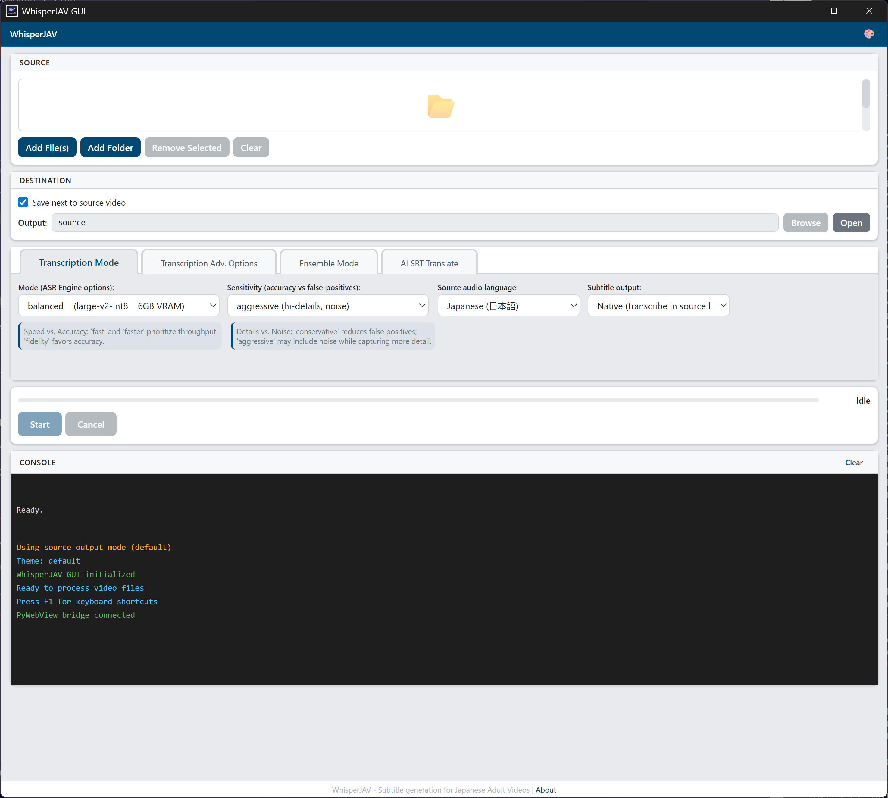
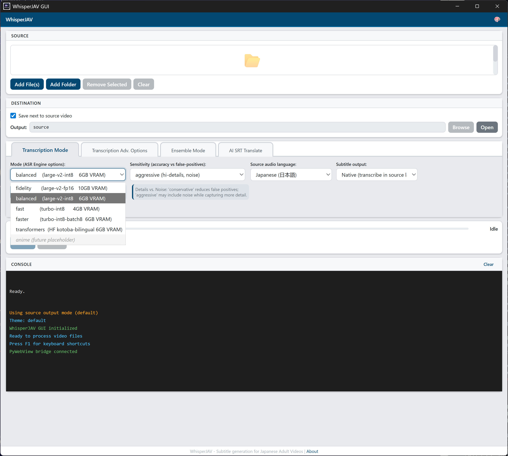
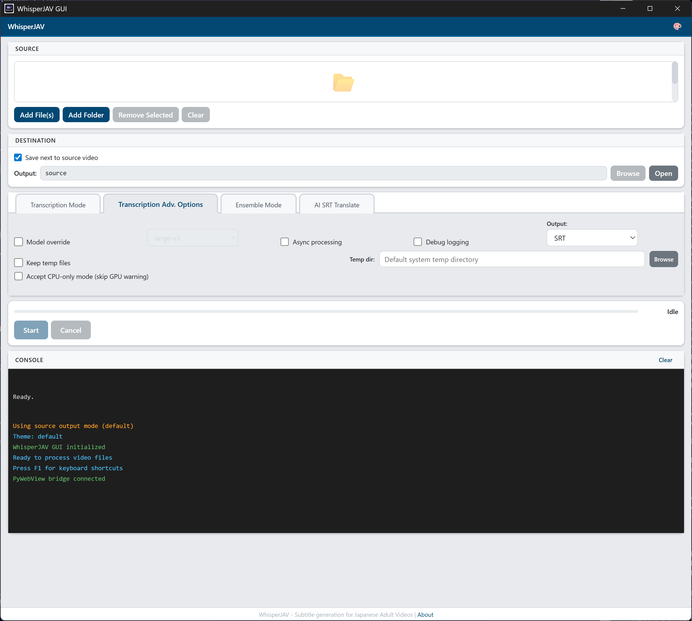
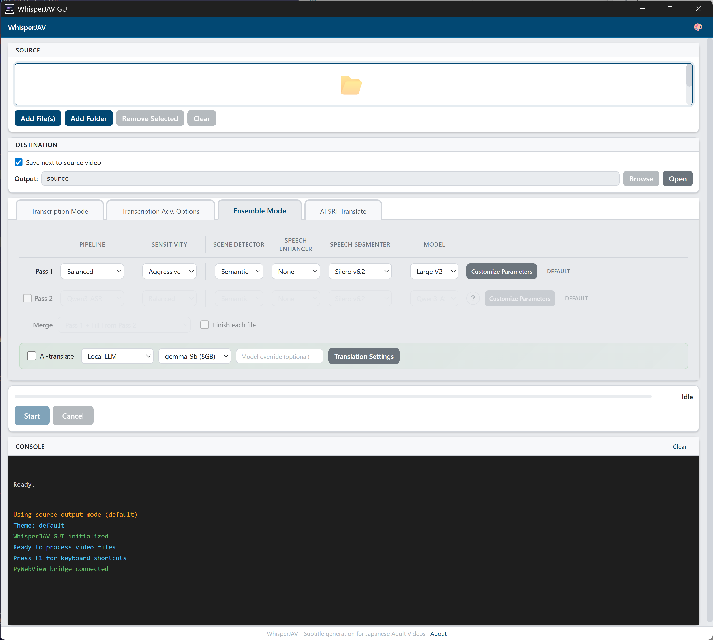
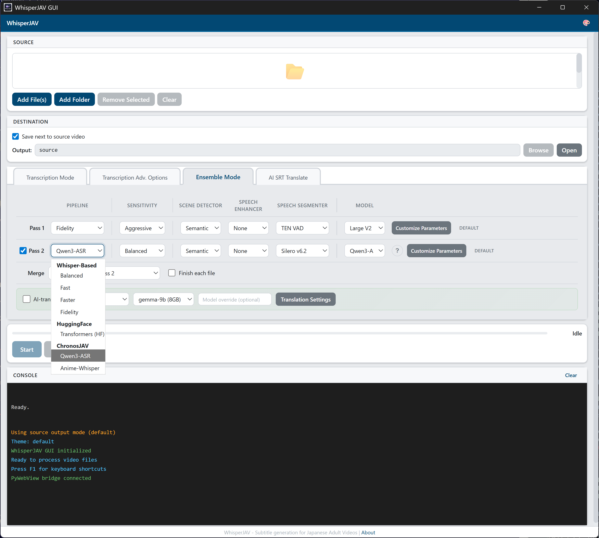
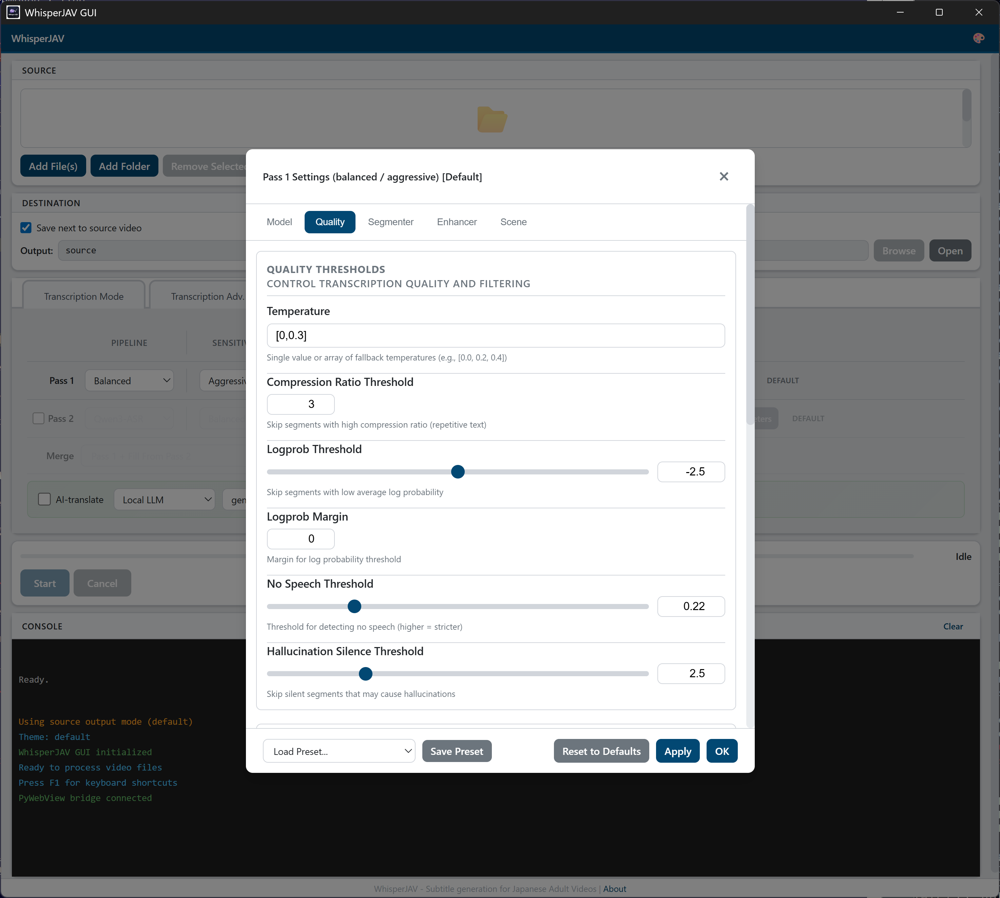
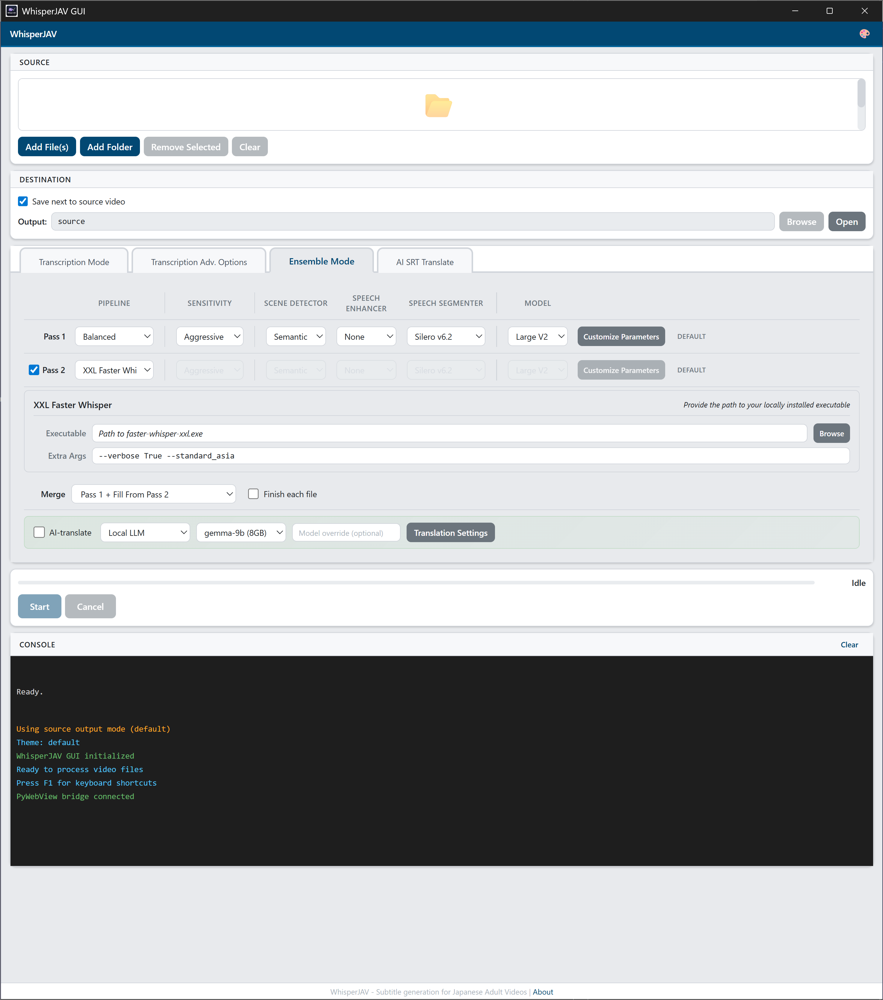
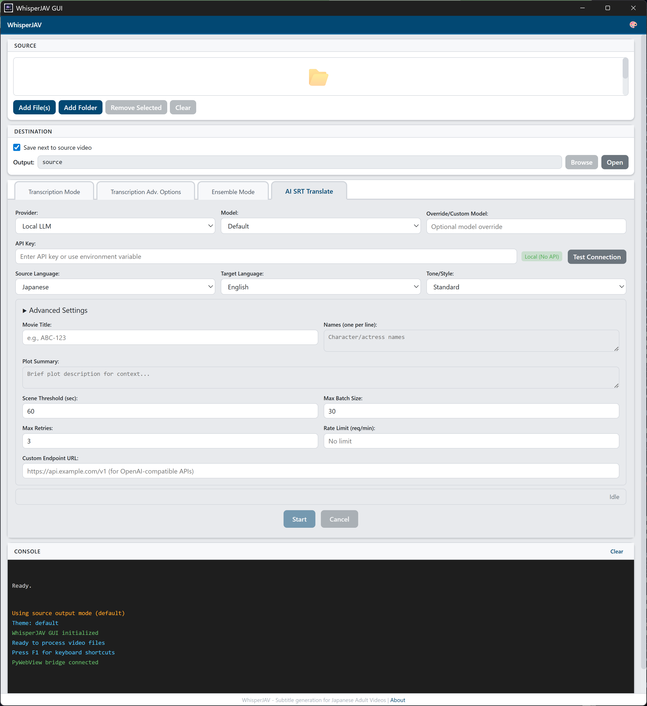
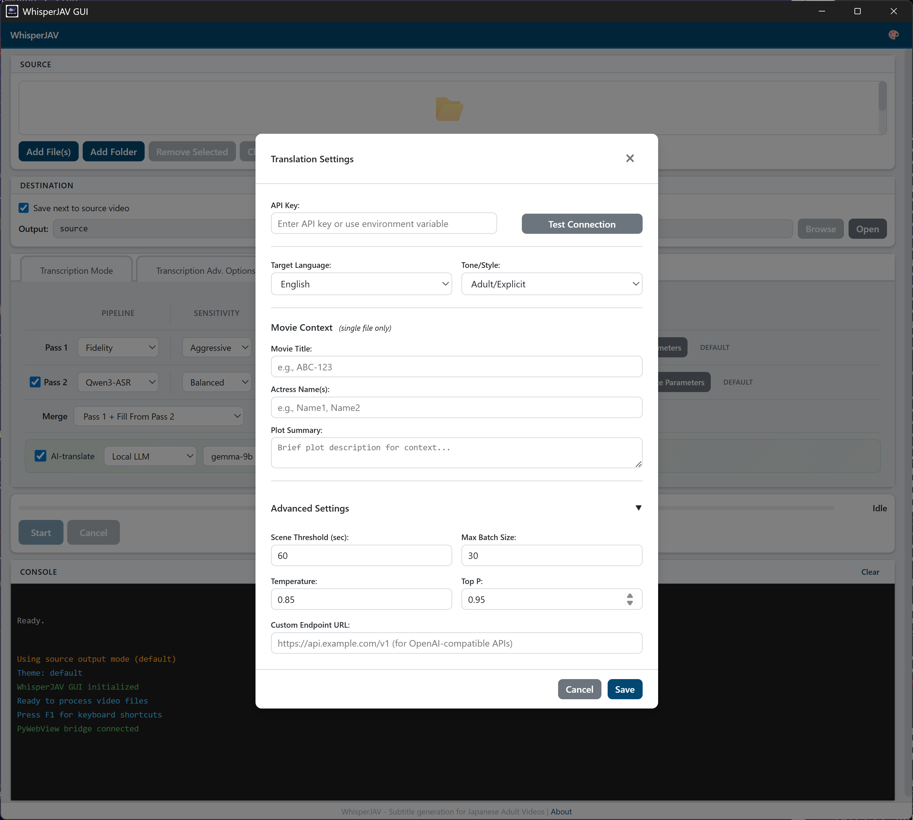

# WhisperJAV GUI User Guide

> Screenshots from v1.8.10 · Windows 11

---

## Table of Contents

1. [Launching the App](#1-launching-the-app)
2. [Interface Overview](#2-interface-overview)
3. [Adding Files](#3-adding-files)
4. [Choosing an Output Location](#4-choosing-an-output-location)
5. [Basic Transcription](#5-basic-transcription)
6. [Advanced Options](#6-advanced-options)
7. [Ensemble Mode (Two-Pass)](#7-ensemble-mode-two-pass)
8. [AI Subtitle Translation](#8-ai-subtitle-translation)
9. [Running a Job](#9-running-a-job)
10. [Console Output](#10-console-output)
11. [Menus & Dialogs](#11-menus--dialogs)
12. [Keyboard Shortcuts](#12-keyboard-shortcuts)
13. [Common Workflows](#13-common-workflows)

{ loading=lazy }

---

## 1. Launching the App

After installation, launch WhisperJAV from:

- **Desktop shortcut** — created automatically by the installer
- **Start menu** — search "WhisperJAV"
- **Command line** — `whisperjav-gui`

When the window opens, WhisperJAV checks only that the GUI's own parts are installed, and on Windows the WebView2 runtime. `whisperjav --check` on the command line checks the rest of the install (Python, PyTorch and the GPU, FFmpeg, CrispASR and its models). The start of every run checks that this install's GPU can be used (see [When a run does not start](#when-a-run-does-not-start)).

---

## 2. Interface Overview

The GUI is divided into five areas, top to bottom:

| Area | Purpose |
|------|---------|
| **Header bar** | Language button (English / 中文), theme button (4 themes, and **Check for Updates**), and an update notice when a new version is out |
| **Source** | Add video/audio files to process |
| **Destination** | Where to save output SRT files |
| **Options tabs** | Four tabs of configuration (see sections 5–8) |
| **Run controls & Console** | Progress bar, Start/Cancel, and real-time log output |

### Themes

Click the palette icon in the header to open the theme menu:

| Theme | Description |
|-------|-------------|
| Default | Light theme with blue accents |
| Google | Material Design inspired |
| Carbon | IBM Carbon dark theme |
| Primer | GitHub-style neutral palette |

### Interface language (English / 中文)

The **中文** button in the header, next to the palette icon, switches the window to Simplified Chinese. In Chinese the button
reads **English** and switches back. The change is immediate; the file list and a run in progress are not affected.

- **In Chinese:** tabs, buttons, menus, tooltips, pop-up boxes, Customize Parameters and Translation Settings.
- **Stays English:** the console, file names, the messages written while files are processed, and the Parameter Guide page.
- The language is kept for the next start, whether or not **Remember settings** is ticked. On Windows, the very first start
  follows the display language: Chinese when Windows is set to Chinese, English otherwise.

---

## 3. Adding Files

WhisperJAV takes video files ending in .mp4, .mkv, .avi, .mov, .wmv, .flv, .webm, .m4v, .mpg or .mpeg, and audio files ending in .mp3, .wav, .flac, .aac, .ogg, .wma, .m4a, .m4b or .opus. Files with other endings are skipped.

### Adding files

- **Drag and drop** files directly onto the file list area
- **Add File(s)** button — opens a multi-select file dialog
- **Add Folder** button — adds the folder to the list; the run then takes every media file in it and in its sub-folders

Each file or folder appears in the list with its full path.

### Managing the file list

- **Remove Selected** — removes highlighted files from the list
- **Clear** — removes all files

---

## 4. Choosing an Output Location

By default, SRT files are saved next to the source video. Uncheck **"Save next to source video"** to pick a custom output folder.

| Setting | Behavior |
|---------|----------|
| Checked (default) | Output SRT saved in the same folder as each source video |
| Unchecked | All SRT files saved to the chosen output directory |

When unchecked, use **Browse** to select a folder, or **Open** to view it in File Explorer.

---

## 5. Basic Transcription

The **Transcription Mode** tab (Tab 1) controls the core transcription pipeline.

{ loading=lazy }

### Mode

Selects the processing pipeline. Each mode trades speed for accuracy.

{ loading=lazy }

| Mode | Backend | Scene Detection | VAD | Best For |
|------|---------|-----------------|-----|----------|
| **Fidelity** | Whisper | Yes | Full | Maximum accuracy, slow |
| **Balanced** (default) | Whisper | Yes | Yes | General use |
| **Fast** | Whisper | Yes | No | Quick results with scene awareness |
| **Faster** | Faster-Whisper | No | No | Maximum speed, minimal processing |
| **Transformers** | HuggingFace | No (by default) | No | Alternative backend |

### Sensitivity

Controls how aggressively the system detects and segments speech.

| Sensitivity | Description |
|-------------|-------------|
| **Aggressive** (default) | Lower thresholds, captures more speech including quiet passages |
| **Balanced** | Middle ground |
| **Conservative** | Higher thresholds, fewer false positives, may miss quiet speech |

### Source Language

The language spoken in the video. Affects Whisper's language hint and post-processing rules.

- **Japanese** (default) — optimized with Japanese-specific regrouping, particle detection, aizuchi handling
- **Korean**, **Chinese**, **English** — standard Whisper processing

### Subtitle Output

- **Native** (default) — subtitles in the original spoken language
- **Direct-to-English** — Whisper translates to English during transcription (lower quality than dedicated translation)

---

## 6. Advanced Options

The **Transcription Adv. Options** tab (Tab 2) provides additional controls for troubleshooting and fine-tuning.

{ loading=lazy }

| Option | Default | Description |
|--------|---------|-------------|
| **Model override** | Off | When checked, forces a specific Whisper model size instead of the pipeline default |
| **Model** dropdown | large-v2 | Greyed out until **Model override** is ticked. Options: large-v2, large-v3, turbo |
| **Output format** | SRT | Output format: SRT, VTT, or Both |
| **Async processing** | Off | Enables asynchronous pipeline execution |
| **Debug logging** | Off | Shows WhisperJAV's debug lines in the console and keeps the metadata files in the temp folder (same as `--debug`) |
| **Keep temp files** | Off | Preserves intermediate audio chunks and processing artifacts |
| **Temp dir** | System default | Where a run's intermediate files go; they are removed at the end unless **Keep temp files** is ticked |

---

## 7. Ensemble Mode (Two-Pass)

The **Ensemble Mode** tab (Tab 3) runs one or two pipelines on each file; with **Pass 2** ticked, the two passes' subtitles are merged into one file.

{ loading=lazy }

### How Ensemble Works

1. **Pass 1** processes the video with one pipeline configuration
2. **Pass 2** (optional) processes the same video with a different configuration
3. The two SRT outputs are **merged** using a configurable strategy

### Pass Configuration

Always active. Each pass has identical controls:

| Control | Options | Default |
|---------|---------|---------|
| **Pipeline** | Whisper-Based: Balanced, Fast, Faster, Fidelity; HuggingFace: Transformers (HF); ChronosJAV: Qwen3-ASR, Anime-Whisper; External (BYOP): XXL Faster Whisper; GGUF via crispasr: parakeet, cohere; Experimental, open to feedback: reazonspeech, kotoba, whisper-turbo, whisper-large, MOSS | Pass 1: cohere; Pass 2: parakeet (off until ticked) |
| **Sensitivity** | Aggressive, Balanced, Conservative | set when you choose the pipeline: Pass 1 (cohere) Balanced, Pass 2 (parakeet) Aggressive |
| **Scene Detector** | Auditok, Silero, Semantic, None | Semantic |
| **Speech Enhancer** | None, FFmpeg DSP, ZipEnhancer, htdemucs (BS-RoFormer and ZipEnhancer ONNX: coming soon) | None |
| **Speech Segmenter** | Silero v4.0, Silero v3.1, Silero v6.2, TEN VAD, WhisperSeg (JA-ASMR), FireRedVAD, None; for Balanced, the Silero version of its built-in VAD: 3.1, 4.0 (default), 6.2; for a GGUF pass, None sends each scene to the model whole | set when you choose the pipeline: Pass 1 (cohere) FireRedVAD, Pass 2 (parakeet) TEN VAD |
| **Model** | the models of the chosen pipeline | the pipeline's default |

### Available Pipelines

The pipeline dropdown groups options by backend:

{ loading=lazy }

- **Whisper-Based**: Balanced, Fast, Faster, Fidelity
- **HuggingFace**: Transformers
- **ChronosJAV**: Qwen3-ASR, Anime-Whisper
- **GGUF via crispasr**: parakeet (Parakeet-CrispASR), cohere (Cohere-CrispASR); below a divider line, **Experimental, open to feedback**: reazonspeech (ReazonSpeech-CrispASR), kotoba (Kotoba-CrispASR), whisper-turbo (Whisper-Turbo-CrispASR), whisper-large (Whisper-Large-CrispASR), MOSS (MOSS-CrispASR) — Japanese only, all experimental; parakeet and cohere since 1.10.0, the other five new in 1.10.1 (see [GGUF pipelines (CrispASR)](../pipelines/crispasr.md))
- **External (BYOP)**: XXL Faster Whisper (Pass 1, Pass 2 or both)

### Customize Parameters

Click the **Customize Parameters** button on a pass to open its settings window. Its tabs depend on the pass's pipeline (below).

{ loading=lazy }

The tabs depend on the pass's pipeline: **Model**, **Quality**, **Segmenter**, **Enhancer** and **Scene** for Balanced, Fast, Faster and Fidelity; **Model**, **Quality**, **Chunking**, **Enhancer** and **Scene** for Transformers; **Model**, **Audio**, **Generation**, **Alignment** and **Output** for Qwen3-ASR and Anime-Whisper; the GGUF passes are described below. For XXL Faster Whisper the button is greyed out: XXL uses its own settings. A badge shows **DEFAULT** or **CUSTOM** to indicate whether parameters have been modified.

The **Model** tab has a **Device** menu: **Auto (the GPU when one can be used, else the CPU)** (the default), **NVIDIA GPU (CUDA)** or **CPU (not accelerated)**.

For a GGUF pass (any pipeline under **GGUF via crispasr** or **Experimental, open to feedback**), the modal has four tabs: **Segmenter**, **Enhancer**, **Scene** and **Timing**; for **MOSS** (MOSS-CrispASR) it also has a **MOSS** tab. They start from the values the pass runs with. A status panel under the pass row shows the model (downloaded or not) and where CrispASR will run, for example "GPU: asks for the NVIDIA GPU (CUDA)". The **Timing** tab has one menu, **Word timestamps**: **From the model** or **From the aligner (wav2vec2-ja)**, with the pipeline's default marked "(default)". When the pass's subtitle times come from the aligner (the default for cohere, or any GGUF pass set to From the aligner), the status panel also lists the aligner.

For a ChronosJAV pass (Qwen3-ASR, Anime-Whisper), the **Alignment** tab sets the subtitle timing (see [Subtitle timing](../pipelines/chronosjav.md#subtitle-timing-1100)):

| Control | Options | Default |
|---|---|---|
| **Aligner Backend** | CrispASR (GGUF, recommended), Qwen3 ForcedAligner (PyTorch), None (no aligner) | CrispASR |
| **Aligner Model** | the models of the chosen backend: `wav2vec2-ja` (recommended), `parakeet-ctc-ja` (not recommended), `qwen3-fa-gguf`; or Qwen3-ForcedAligner-0.6B (PyTorch) | `wav2vec2-ja` |
| **Timestamp Mode** | Aligner + VAD Fallback, Aligner + Interpolation, Aligner Only (no recovery on collapse), VAD Only (no aligner loaded) | VAD Only |
| **Timing Model (Whisper)** | Whisper small, None (no timing model) | None |
| **Adaptive Step-Down** | a tick box | not ticked |

Since 1.10.1 the default is VAD Only with no timing model, ChronosJAV's timing of 1.9.5: no aligner is loaded, and the Aligner Backend, Aligner Model and Adaptive Step-Down controls are hidden until an aligner mode is chosen. With Aligner Backend **None**, the run uses VAD Only with Step-Down off, whatever Timestamp Mode and Adaptive Step-Down show. A status panel under a ChronosJAV pass row shows the CrispASR aligner and the timing model when the pass uses them (downloaded or not) and where CrispASR runs them. Since 1.10.0 the Alignment tab's values, and a preset saved from it, reach the run; from 1.8.10.post3 to 1.9.5 they were ignored.

At the bottom of the window, **Save Preset** saves this pass's settings (pipeline, sensitivity, scene detector, speech enhancer, speech segmenter, model and the window's values) under a name, and **Load Preset...** loads one into the pass. Presets are kept for the next start.

### Pass 2 Configuration

Check the **Pass 2** checkbox to enable the second pass. Controls are identical to Pass 1.

When disabled, the row is greyed out and all controls are inactive.

### BYOP: XXL Faster Whisper (v1.8.9+; Pass 1 since 1.10.0)

Select **XXL Faster Whisper** as the pipeline of Pass 1, Pass 2 or both to use [PurfView's Faster Whisper XXL](https://github.com/Purfview/whisper-standalone-win) as an external program. The menu lists it under **External (BYOP)**: XXL is a separate program that you download yourself; WhisperJAV runs it.

{ loading=lazy }

When a pass is XXL, its **Model** column picks the Whisper model XXL runs, and a settings panel appears below the Pass 2 row:

| Field | Description |
|-------|-------------|
| **Model** (in the pass row) | Large V2 (default), Large V3, Large V3 Turbo or Medium. XXL downloads the model the first time it is used. When both passes are XXL, each has its own model. |
| **Executable** | Path to your `faster-whisper-xxl.exe`. Click **Browse** to select it. Both passes use the same one. |
| **Extra Args** | Any additional flags to pass to XXL (default `--verbose True --standard_asia`). Choose the model in the Model column: a `--model` here is not used, and the console says so. |

The other controls of an XXL pass (Sensitivity, Scene Detector, Speech Enhancer, Speech Segmenter, Customize) are greyed out: XXL uses its own settings. WhisperJAV sends XXL the input file, the output folder, the model, the language and the SRT output format (and `--task translate` when the subtitles are to be in English); you add any other XXL flags in the Extra Args field. XXL's real-time console output is streamed to the GUI console.

Before 1.10.0 the GUI sent no model to XXL, so XXL ran large-v3 even when Extra Args said `--model large-v2` (#449).

If XXL fails for a file, the console says which pass failed and why. A failed Pass 1 marks the file failed; a failed Pass 2 leaves the file with Pass 1's subtitles, if Pass 1 made them. If XXL crashes during shutdown (a known ctranslate2 behavior) but the SRT was already written, WhisperJAV keeps the valid output instead of discarding it.

### Speech Enhancement: FFmpeg DSP

When **FFmpeg DSP** is selected as the speech enhancer, an additional panel appears with 8 audio processing effects:

| Effect | Description |
|--------|-------------|
| Loudness Normalization | Normalize overall loudness to a standard level |
| Dynamic Normalization | Even out volume differences between quiet and loud sections |
| Compression | Reduce dynamic range |
| Denoise | Remove background noise |
| High-pass Filter | Remove low-frequency rumble |
| Low-pass Filter | Remove high-frequency hiss |
| De-esser | Reduce harsh sibilance (s/t sounds) |
| Amplify | Boost overall volume |

### Enhance for VAD Only (v1.8.10+)

When a speech enhancer is selected (anything other than "None"), a checkbox appears below the enhancer dropdown:

**Enhance for VAD only** — When ticked, the enhanced audio is used only to find the speech (VAD). The original audio is sent to the ASR model for transcription.

The box is not shown for Balanced and XXL Faster Whisper, nor when the enhancer is "None". It takes effect with Fidelity, Qwen3-ASR, Anime-Whisper and the GGUF pipelines; Fast, Faster and Transformers ignore it, as they run no separate speech segmenter.

### Merge Strategy

When Pass 2 is enabled, choose how the two outputs are combined:

| Strategy (GUI) | Command line | What it does |
|----------|----------|----------|
| **Pass 1 + Fill From Pass 2** (default) | `pass1_primary` | Keeps every Pass 1 subtitle; adds a Pass 2 subtitle only where it overlaps no Pass 1 subtitle |
| **Smart Merge (Best Quality)** | `smart_merge` | Pairs each Pass 1 subtitle with the Pass 2 subtitle that overlaps it most, if the overlap is at least 30% of the shorter one, and keeps one of the pair: the one with more of its own length inside the overlap; if that is about equal, the one with more text (a line of few different characters, such as ああああああああああ, counts as none); then the shorter one. Subtitles without a partner are kept from both passes |
| **Full Merge (All Lines)** | `full_merge` | Keeps every subtitle of both passes, in time order; overlapping subtitles stay |
| **Pass 2 + Fill From Pass 1** | `pass2_primary` | As Pass 1 + Fill From Pass 2, with the passes swapped |
| **Pass 1 + Fill (30% Overlap)** | `pass1_overlap` | Keeps every Pass 1 subtitle; adds a Pass 2 subtitle unless it overlaps a Pass 1 subtitle by more than 30% of that subtitle's length |
| **Pass 2 + Fill (30% Overlap)** | `pass2_overlap` | As above, with the passes swapped |
| — (command line only) | `longest` | Pairs subtitles as Smart Merge does and keeps the one with more text |

With every strategy, a subtitle whose text is the same as the one just before it is then removed.

### Serial Mode

**Finish each file** is ticked by default: each file is finished (Pass 1 → Pass 2 → Merge) before the next one starts, so a file's subtitles are ready as soon as it is done and a crash in one file does not lose the others. Untick it to run Pass 1 on all files, then Pass 2: each pass then starts once for all the files instead of once per file. With **Remember settings** on, the box keeps its state for the next start.

### Inline AI Translation (Ensemble)

Check **"AI-translate"** after the merge strategy to automatically translate the merged output. This shows an inline provider/model selector and a settings button.

---

## 8. AI Subtitle Translation

The **AI SRT Translate** tab (Tab 4) is a standalone tool for translating existing SRT files using AI language models.

{ loading=lazy }

### Provider & Model

Providers are grouped into **Local LLM** and **Cloud AI** in the dropdown.

| Provider | Notes |
|----------|-------|
| **Ollama** | Connects to your locally installed Ollama. Free, private, no API key. See below. |
| **DeepSeek** | Cloud API. Cost-effective, good quality for CJK languages. |
| **Gemini** | Google's API. Good multilingual support. |
| **Claude** | Anthropic's API. High quality, higher cost. |
| **GPT** | OpenAI's API. Widely available. |
| **OpenRouter** | Meta-router supporting many models. |
| **GLM** | Zhipu AI. Good for Chinese-related tasks. |
| **Groq** | Fast inference cloud provider. |
| **Custom** | Any OpenAI-compatible endpoint. |

Each provider populates a **Model** dropdown with available models. Use **Override/Custom Model** to specify a model ID not in the list.

### Ollama Integration (v1.8.10+)

WhisperJAV connects to your locally installed [Ollama](https://ollama.com). You must install Ollama separately — WhisperJAV does not include it.

When you select Ollama as the provider, the GUI detects your setup and shows one of three panels:

| State | What you see | What to do |
|-------|-------------|------------|
| **Not installed** | Download link and "Check Again" button | Install Ollama from ollama.com, then click "Check Again" |
| **No model** | Recommended model with `ollama pull` command | Copy the command and run it in your terminal, or select a model from the dropdown to download it |
| **Connected** | Green status dot, model dropdown populated | Select a model and proceed |

The model dropdown is split into two groups:

- **Installed Models** — models already on your machine (shown with download sizes)
- **Recommendations** — suggested models you haven't installed yet

Selecting an uninstalled model opens a download confirmation popup. The model is pulled directly from within the GUI.

VRAM-based recommendations:

| GPU VRAM | Recommended Model |
|----------|-------------------|
| 4 GB | gemma3:4b |
| 8 GB | qwen2.5:7b |
| 12 GB | gemma3:12b |
| 16 GB+ | qwen2.5:14b |

After translation completes, WhisperJAV automatically unloads the model from VRAM so your GPU is free for other work.

If Ollama is installed but not running, the GUI starts the server automatically.

### API Key & Connection Test

For cloud providers, enter your API key and click **Test Connection** to verify it works. A status icon shows the result.

- Green checkmark: connection successful
- Red X: connection failed (check key and endpoint)

Ollama does not require an API key.

### Language & Tone

| Setting | Options | Default |
|---------|---------|---------|
| **Source Language** | Japanese, Korean, Chinese, English | Japanese |
| **Target Language** | English, Chinese, Indonesian, Portuguese, Spanish, French, Italian, Thai, Korean | English |
| **Tone/Style** | Standard, Adult (contextual), Adult/Explicit | Standard |

**Standard** tone produces clean, natural translations. **Adult (contextual)** uses explicit language only where the original line is explicit; neutral dialogue stays neutral. **Adult/Explicit** makes everything explicit, neutral dialogue too.

### Advanced Settings

Click the collapsible **Advanced Settings** section to reveal additional options:

| Setting | Default | Description |
|---------|---------|-------------|
| **Movie Title** | (empty) | Provides context to the AI for better translation |
| **Names (one per line)** | (empty) | Character or actress names, for the AI to handle correctly |
| **Plot Summary** | (empty) | Additional context for the AI translator |
| **Scene Threshold** | 60 sec | How the translator groups subtitles into scenes for batch processing |
| **Max Batch Size** | 30 | Maximum subtitles per translation batch |
| **Max Retries** | 3 | Retry count for failed API calls |
| **Rate Limit (req/min)** | (empty; the field shows "No limit") | Requests per minute limit |
| **Custom Endpoint** | (empty) | Override the default API endpoint URL |

### Translation Progress

Translation has its own progress bar and Start/Cancel buttons at the bottom of Tab 4. The main Run Controls section is hidden while Tab 4 is active.

---

## 9. Running a Job

### Starting

1. Add one or more files (Section 3)
2. Configure options on the relevant tab
3. Click **Start**

While a run is going, the progress bar moves without a percentage and the status reads "Running..."; the console shows each step.

### Cancelling

Click **Cancel** to stop the current job. The process terminates and any partial output is preserved.

### When processing is running

- All file selection and configuration controls are **disabled**
- The **Cancel** button becomes active
- Real-time progress appears in both the progress bar and the console

### Completion

When the run ends, the status shows "Finished" with the number of files in each state (done, empty, suspect, failed, skipped), from the run summary in `whisperjav_run.json`. The output SRT is ready to use with any media player.

---

### When a run does not start

If a run stops before it processes anything, a dialog says why:

| Dialog | When | What you can do |
|---|---|---|
| **The NVIDIA GPU cannot be used** | the install is made for the NVIDIA GPU, and the GPU cannot be used now (for example after a driver change) | **Run on the CPU this time** runs the same job again on the CPU; **Close** leaves it. The dialog names the reason and the fix. |
| **The run did not start** | a setting the run cannot use, or PyTorch missing (for example on an Own PyTorch install before you added your PyTorch) | the dialog says what to do; nothing was processed |
| **The run ended without a run summary** | WhisperJAV stopped unexpectedly | files finished before that are in the output folder; the console shows what happened |

When the install's GPU can be used (an NVIDIA GPU or Apple GPU install), nothing is shown at the start of a run. On every other install, the console shows where each part runs on this computer; the run then goes on.

---

## 10. Console Output

The console at the bottom shows real-time log messages from the processing pipeline.

| Color | Meaning |
|-------|---------|
| Green | Success messages (file saved, processing complete) |
| Yellow | Warnings (fallback activated, parameter adjusted) |
| Red | Errors (file not found, CUDA failure) |
| White/Gray | Informational messages (progress, stage transitions) |

Click **Clear** to reset the console output.

Each run started from the Transcription Mode or Ensemble Mode tab also writes a log file, `whisperjav_run.log`, in a `raw_subs` folder next to the run's `whisperjav_run.json`: in the output folder, or, with **Save next to source video**, in the folder of the first file in the list (inside the folder, if the first entry is a folder). It holds WhisperJAV's lines, the debug lines included, and CrispASR's start-up lines. It leaves out the start banner, the RUN SUMMARY table (that is in `whisperjav_run.json`), the total processing time, the translation lines, other libraries' warnings and the lines of the balanced pipeline's ASR worker. Each Ensemble pass writes its own file beside it (`whisperjav_run.pass1.log`, `whisperjav_run.pass2.log`). Each run replaces the last run's log files.

---

## 11. Menus & Dialogs

### About Dialog

Press **F1**, or click **About** at the bottom of the window. Shows version info, feature list, and keyboard shortcuts.

### Update Check

WhisperJAV checks for updates automatically on startup (after a 3-second delay). When a new version is available, a subtle indicator appears in the header bar showing the version number. Click it to view the changelog.

For critical updates, a full banner appears at the top of the window.

You can also check manually: click the palette icon in the header, then **Check for Updates**.

### Translation Settings Modal

Accessible from the **Translation Settings** button in the Ensemble tab's AI-translate row. Provides the same configuration as Tab 4 in a compact modal.

{ loading=lazy }

---

## 12. Keyboard Shortcuts

| Shortcut | Action |
|----------|--------|
| **Ctrl+O** | Open file dialog (add files) |
| **Ctrl+R** | Start processing |
| **Escape** | Cancel current job / close dialogs |
| **F1** | Open About dialog |
| **Arrow keys** | Navigate file list |

---

## 13. Common Workflows

### Quick Transcription

1. Drag a video file onto the app
2. Leave defaults (Balanced mode, Aggressive sensitivity, Japanese)
3. Click **Start**
4. SRT appears next to your video file

### Two-Pass Transcription (Ensemble)

1. Add files
2. Go to the **Ensemble Mode** tab
3. Pass 1 starts on **cohere** (Balanced, Semantic, FireRedVAD); keep it or choose another pipeline
4. Tick **Pass 2** and choose its pipeline (it starts on **parakeet**)
5. Under **Merge**, choose a strategy (default **Pass 1 + Fill From Pass 2**)
6. Click **Start**
7. Two passes run sequentially, then results are merged

### Transcribe + Translate in One Step

1. Add files
2. Go to **Ensemble** tab
3. Configure passes as desired
4. Check **"AI-translate"**
5. Select provider, enter API key if needed
6. Click **Start**
7. Get translated SRT automatically after transcription

### Translate an Existing SRT

1. Go to **AI SRT Translate** tab (Tab 4)
2. Add your SRT file(s)
3. Select provider and model
4. Enter API key and test connection
5. Set target language
6. Click **Start**

### Translate with Ollama (Free, Local)

1. Install [Ollama](https://ollama.com) on your machine
2. Go to **AI SRT Translate** tab (Tab 4)
3. Select **Ollama** from the provider dropdown
4. Wait for the green "connected" status
5. Select or download a model (e.g., gemma3:4b for 4GB VRAM, qwen2.5:7b for 8GB)
6. Add your SRT file(s) and click **Start**
7. No API key or internet needed — everything runs locally on your GPU

### Without a GPU

On an install made for the CPU only, there is nothing to tick: every run uses the CPU. Use **Faster** mode for the best speed. Processing is several times slower than on a GPU, but works. To run one pass on the CPU on a GPU install, choose **CPU (not accelerated)** as the **Device** in the **Model** tab of that pass's **Customize Parameters** window. A GGUF or XXL pass has no Device menu: it follows the whole run's device (`--device` on the command line).
