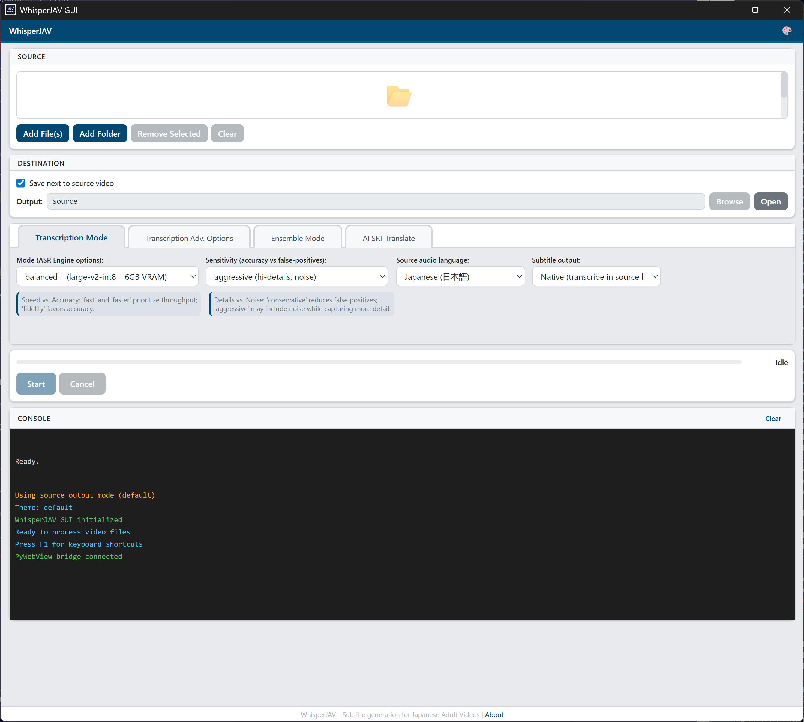
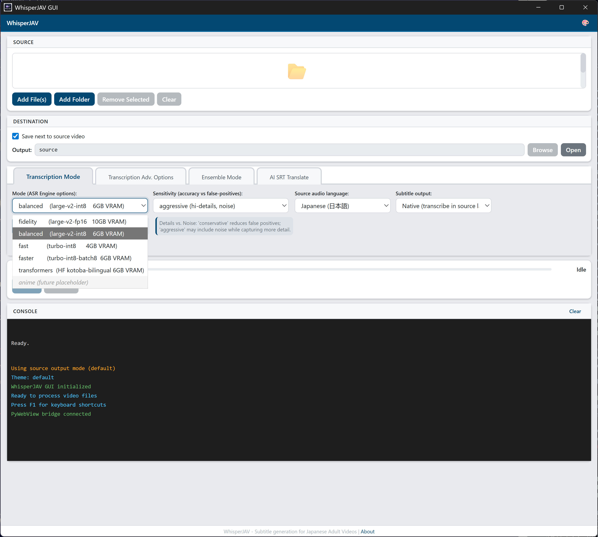
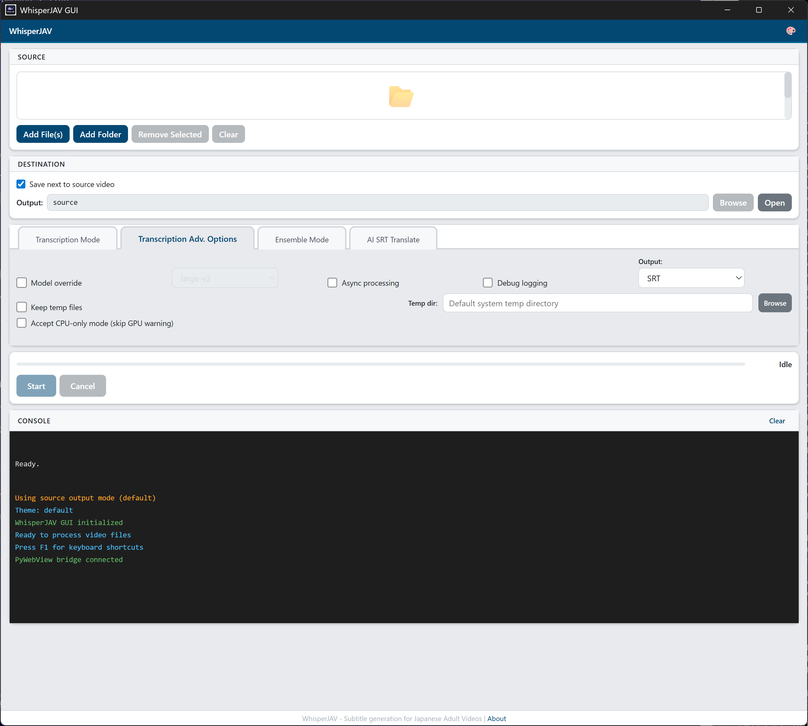
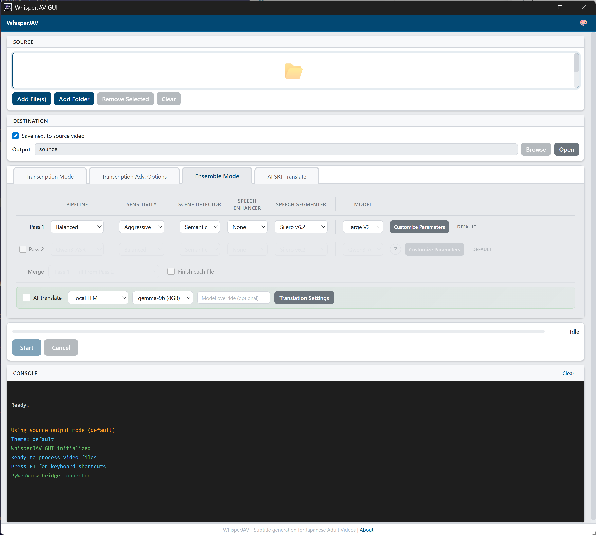
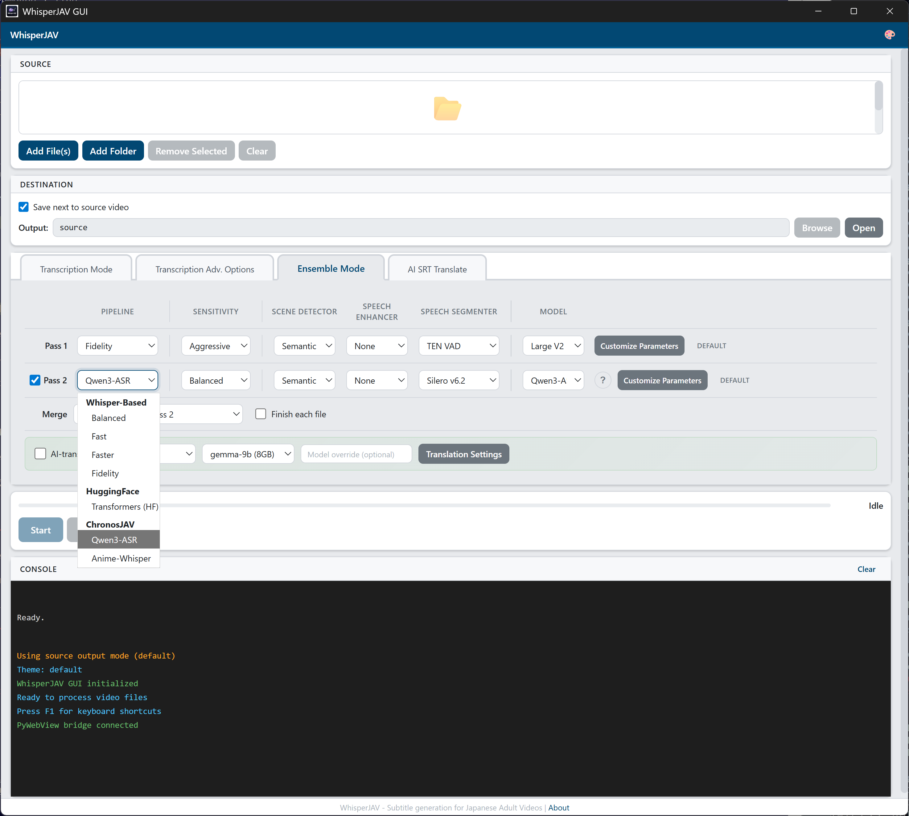
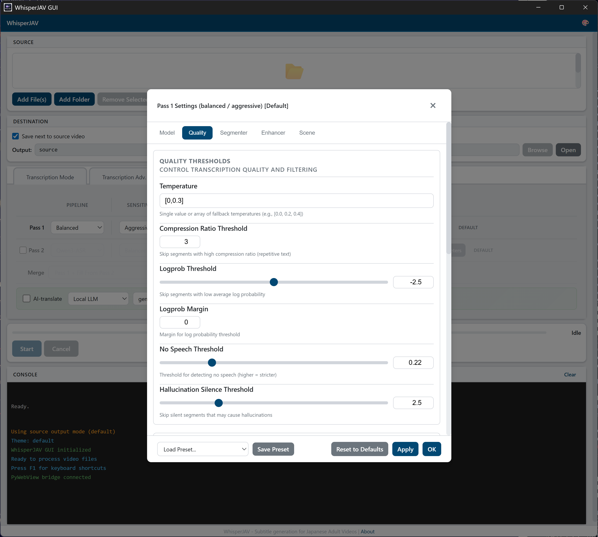
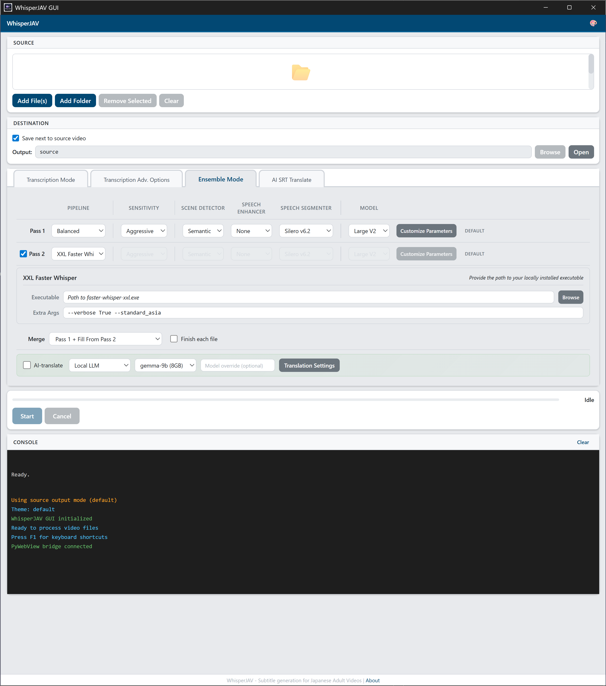
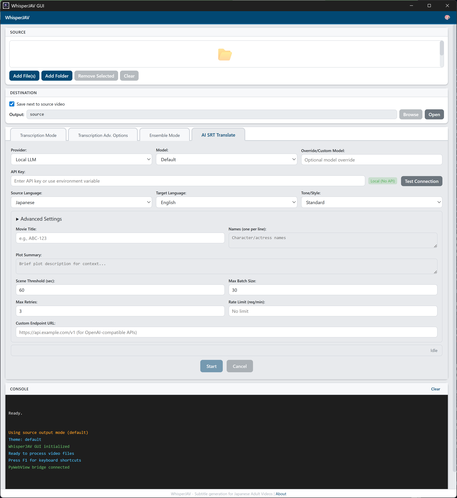
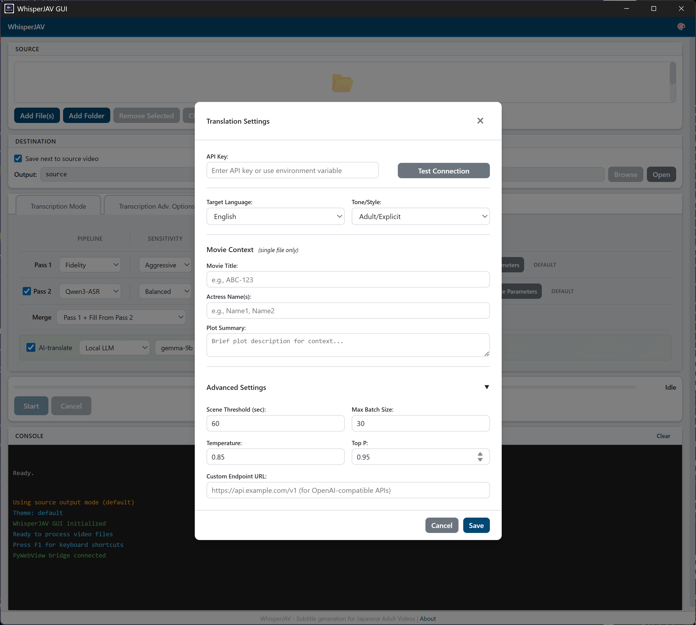

# WhisperJAV GUI 用户指南

> 截图来自 v1.8.9 · Windows 11

---

## 目录

1. [启动应用](#1-启动应用)
2. [界面概览](#2-界面概览)
3. [添加文件](#3-添加文件)
4. [选择输出位置](#4-选择输出位置)
5. [基础模式](#5-基础模式)
6. [高级选项](#6-高级选项)
7. [专家模式（两轮）](#7-专家模式两轮)
8. [AI 字幕翻译](#8-ai-字幕翻译)
9. [运行任务](#9-运行任务)
10. [控制台输出](#10-控制台输出)
11. [菜单与对话框](#11-菜单与对话框)
12. [键盘快捷键](#12-键盘快捷键)
13. [常见工作流程](#13-常见工作流程)

{ loading=lazy }

---

## 1. 启动应用

安装完成后，可以通过以下方式启动 WhisperJAV：

- **桌面快捷方式** — 由安装程序自动创建
- **开始菜单** — 搜索 "WhisperJAV"
- **命令行** — `whisperjav-gui`

窗口打开时，WhisperJAV 只检查 GUI 自身需要的部分是否已安装，在 Windows 上还检查 WebView2 运行库。安装的其余部分（Python、PyTorch 和 GPU、FFmpeg、CrispASR 及其模型）可在命令行中用 `whisperjav --check` 检查。每次运行开始时，还会检查本安装的 GPU 是否可用（见[运行没有开始时](#运行没有开始时)）。

---

## 2. 界面概览

GUI 从上到下分为五个区域：

| 区域 | 用途 |
|------|------|
| **顶部栏** | 界面语言按钮（English / 中文）、主题按钮（4 种主题，以及 **检查更新**（Check for Updates）），有新版本时还有更新提示 |
| **来源** | 添加要处理的视频/音频文件 |
| **目标** | 设置输出 SRT 文件的保存位置 |
| **选项标签页** | 四个配置标签页（参见第 5-8 节） |
| **运行控制和控制台** | 进度条、开始/取消按钮和实时日志输出 |

### 主题

点击顶部栏中的调色板图标切换主题：

| 主题 | 描述 |
|------|------|
| Default | 蓝色调的浅色主题 |
| Google | Material Design 风格 |
| Carbon | IBM Carbon 深色主题 |
| Primer | GitHub 风格的中性色调 |

### 界面语言（English / 中文）

点击顶部栏调色板图标旁的 **中文** 按钮，窗口即切换为简体中文；切换后按钮显示 **English**，再点一次即切回英文。切换立即生效，不影响文件列表和正在进行的运行。

- **切换为中文的内容：** 标签页、按钮、菜单、提示文字、弹出对话框、自定义参数（Customize Parameters）和翻译设置。
- **保持英文的内容：** 控制台、文件名、处理文件时写出的信息，以及参数指南（Parameter Guide）页面。
- 所选语言在下次启动时保留，与是否勾选“记住设置”（Remember settings）无关。在 Windows 上，首次启动时界面跟随系统显示语言：系统为中文时显示中文，否则显示英文。

本指南中的控件名称多数写成中文界面的名称，括号中为英文界面的名称；有些地方仍只写英文界面的名称。中文界面中的主要名称如下：

| 英文界面 | 中文界面 |
|------|------|
| Transcription Mode | 基础模式 |
| Transcription Adv. Options | 高级选项 |
| Ensemble Mode | 专家模式 |
| AI SRT Translate | AI 字幕翻译 |
| Pass 1 / Pass 2 | 第一轮 / 第二轮 |
| Aggressive / Balanced / Conservative（灵敏度） | 高灵敏 / 中灵敏 / 低灵敏 |
| Customize Parameters | 自定义参数 |
| AI-translate | AI 字幕翻译 |
| Start / Cancel | 开始 / 取消 |

---

## 3. 添加文件

WhisperJAV 接受扩展名为 .mp4、.mkv、.avi、.mov、.wmv、.flv、.webm、.m4v、.mpg、.mpeg 的视频文件，以及扩展名为 .mp3、.wav、.flac、.aac、.ogg、.wma、.m4a、.m4b、.opus 的音频文件。其他扩展名的文件会被跳过。

### 添加文件

- **拖放** 文件到文件列表区域
- **Add File(s)** 按钮 — 打开多选文件对话框
- **添加文件夹**（Add Folder）按钮 — 把文件夹本身加入列表；运行时处理其中及其所有子文件夹中的媒体文件

列表中的每个文件或文件夹显示其完整路径。

### 管理文件列表

- **Remove Selected** — 从列表中移除选中的文件
- **Clear** — 移除所有文件

---

## 4. 选择输出位置

默认情况下，SRT 文件保存在源视频旁边。取消勾选 **"Save next to source video"** 可以选择自定义输出文件夹。

| 设置 | 行为 |
|------|------|
| 勾选（默认） | 输出 SRT 保存在每个源视频所在的文件夹中 |
| 取消勾选 | 所有 SRT 文件保存到指定的输出目录 |

取消勾选后，使用 **Browse** 选择文件夹，或使用 **Open** 在文件资源管理器中查看。

---

## 5. 基础模式

**基础模式**（Transcription Mode）标签页（标签页 1）控制核心转写处理管线。

{ loading=lazy }

### 模式

选择处理管线。每种模式在速度和精度之间做出不同的权衡。

{ loading=lazy }

| 模式 | 后端 | 场景检测 | 语音活动检测 | 适用场景 |
|------|------|----------|------------|----------|
| **Fidelity** | Whisper | 是 | 完整 | 最高精度，速度较慢 |
| **Balanced**（默认） | Whisper | 是 | 是 | 通用场景 |
| **Fast** | Whisper | 是 | 否 | 具有场景感知的快速转写 |
| **Faster** | Faster-Whisper | 否 | 否 | 最快速度，最少处理 |
| **Transformers** | HuggingFace | 否（默认） | 否 | 替代后端 |

### 灵敏度

控制系统检测和分割语音的灵敏程度。

| 灵敏度 | 描述 |
|--------|------|
| **高灵敏**（默认） | 较低阈值，捕获更多语音（包括安静段落） |
| **中灵敏** | 居中水平 |
| **低灵敏** | 较高阈值，误报更少，可能遗漏安静的语音 |

### 源语言

视频中的说话语言。影响 Whisper 的语言提示和后处理规则。

- **日语**（默认） — 针对日语优化，包含日语分组、助词检测、相槌处理
- **韩语**、**中文**、**英语** — 标准 Whisper 处理

### 字幕输出

- **原语言**（默认） — 以原始语言输出字幕
- **直接转英语** — Whisper 在转写过程中翻译为英语（质量低于专门的翻译工具）

---

## 6. 高级选项

**高级选项**（Transcription Adv. Options）标签页（标签页 2）提供用于故障排除和微调的额外控制。

{ loading=lazy }

| 选项 | 默认值 | 描述 |
|------|--------|------|
| **模型覆盖** | 关闭 | 勾选后，强制使用指定的 Whisper 模型大小，而非处理管线默认值 |
| **模型** 下拉 | large-v2 | 勾选 **模型覆盖**（Model override）之前为灰色不可用。选项：large-v2、large-v3、turbo |
| **输出格式** | SRT | 输出格式：SRT、VTT 或两者 |
| **异步处理** | 关闭 | 启用异步处理管线执行 |
| **调试日志** | 关闭 | 在控制台中显示 WhisperJAV 的调试信息，并保留临时文件夹中的元数据文件（同 `--debug`） |
| **保留临时文件** | 关闭 | 保留中间音频块和处理产物 |
| **临时目录**（Temp dir） | 系统默认 | 一次运行的中间文件存放的位置；运行结束时会删除，除非勾选 **保留临时文件**（Keep temp files） |

---

## 7. 专家模式（两轮）

**专家模式**（Ensemble Mode）标签页（标签页 3）对每个文件运行一个或两个处理管线；勾选 **第二轮**（Pass 2）时，两轮的字幕会合并成一个文件。

{ loading=lazy }

### 专家模式的工作原理

1. **第一轮** 使用一种处理管线配置处理视频
2. **第二轮**（可选）使用另一种配置处理同一视频
3. 两个 SRT 输出通过可配置的策略进行**合并**

### 每一轮的配置

始终处于活动状态。每一轮具有相同的控制项：

| 控制项 | 选项 | 默认值 |
|--------|------|--------|
| **处理管线** | 基于 Whisper：Balanced、Fast、Faster、Fidelity；HuggingFace：Transformers (HF)；ChronosJAV：Qwen3-ASR、Anime-Whisper；外部 (BYOP)：XXL Faster Whisper；GGUF via crispasr：parakeet、cohere；实验性，欢迎反馈：reazonspeech、kotoba、whisper-turbo、whisper-large、MOSS | 第一轮：cohere；第二轮：parakeet（勾选前不运行） |
| **灵敏度** | 高灵敏、中灵敏、低灵敏 | 选择处理管线时随之设定：第一轮（cohere）中灵敏，第二轮（parakeet）高灵敏 |
| **场景检测器** | Auditok、Silero、Semantic、None | Semantic |
| **语音增强器** | None、FFmpeg DSP、ZipEnhancer、htdemucs（BS-RoFormer 和 ZipEnhancer ONNX：即将推出） | None |
| **语音分割器** | Silero v4.0、Silero v3.1、Silero v6.2、TEN VAD、WhisperSeg (JA-ASMR)、FireRedVAD、无（None）；Balanced 时改为其内置 VAD 的 Silero 版本：3.1、4.0（默认）、6.2；GGUF 处理管线选 无 时，每个场景整段交给模型 | 选择处理管线时随之设定：第一轮（cohere）FireRedVAD，第二轮（parakeet）TEN VAD |
| **模型** | 所选处理管线的模型 | 该处理管线的默认模型 |

### 可用处理管线

处理管线下拉菜单按后端分组：

{ loading=lazy }

- **基于 Whisper**：Balanced、Fast、Faster、Fidelity
- **HuggingFace**：Transformers
- **ChronosJAV**：Qwen3-ASR、Anime-Whisper
- **GGUF via crispasr**：parakeet（Parakeet-CrispASR）、cohere（Cohere-CrispASR）；分隔线下方的 **实验性，欢迎反馈**（Experimental, open to feedback）：reazonspeech（ReazonSpeech-CrispASR）、kotoba（Kotoba-CrispASR）、whisper-turbo（Whisper-Turbo-CrispASR）、whisper-large（Whisper-Large-CrispASR）、MOSS（MOSS-CrispASR）——只处理日语，全部为实验性；parakeet 和 cohere 从 1.10.0 起提供，其他五个为 1.10.1 新增（见 [GGUF 处理管线（CrispASR）](../pipelines/crispasr.md)）
- **外部 (BYOP)**：XXL Faster Whisper（第一轮、第二轮或两者）

### 自定义参数

点击某一轮上的 **自定义参数**（Customize Parameters）按钮，打开这一轮的设置窗口。窗口中的标签页取决于这一轮的处理管线（见下文）。

{ loading=lazy }

弹窗的标签页取决于这一轮的处理管线：Balanced、Fast、Faster 和 Fidelity 为 **模型**（Model）、**质量**（Quality）、**分割器**（Segmenter）、**增强器**（Enhancer）和 **场景**（Scene）；Transformers 为 **模型**、**质量**、**分块**（Chunking）、**增强器** 和 **场景**；Qwen3-ASR 和 Anime-Whisper 为 **模型**、**音频**（Audio）、**生成**（Generation）、**对齐**（Alignment）和 **输出**（Output）；GGUF 处理管线见下文。XXL Faster Whisper 的这个按钮是灰色的：XXL 使用它自己的设置。徽标显示 **默认**（DEFAULT）或 **自定义**（CUSTOM），表示参数是否已修改。

**Model** 标签页有一个 **Device** 菜单：**Auto (the GPU when one can be used, else the CPU)**（默认，有可用 GPU 时用 GPU，否则用 CPU）、**NVIDIA GPU (CUDA)** 或 **CPU (not accelerated)**（CPU，不加速）。

对于 GGUF 处理管线（**GGUF via crispasr** 或 **实验性，欢迎反馈** 组中的任一处理管线），弹窗有四个标签页：**分割器**（Segmenter）、**增强器**（Enhancer）、**场景**（Scene）和 **计时**（Timing）；**MOSS**（MOSS-CrispASR）还有一个 **MOSS** 标签页。初始值就是这一轮实际使用的值。这一轮那一行下方的状态面板会显示模型（是否已下载）以及 CrispASR 将在哪里运行，例如“GPU：请求使用 NVIDIA GPU（CUDA）”（英文界面为 "GPU: asks for the NVIDIA GPU (CUDA)"）。**计时**（Timing）标签页只有一个菜单 **词级时间戳来源**（Word timestamps）：**来自模型**（From the model）或 **来自对齐器（wav2vec2-ja）**（From the aligner (wav2vec2-ja)），处理管线的默认项标有（默认）。字幕时间来自对齐器时（cohere 的默认，或在计时标签页中选了来自对齐器的任一 GGUF 处理管线），状态面板还会列出对齐器。

对于 ChronosJAV 处理管线（Qwen3-ASR、Anime-Whisper），**对齐**（Alignment）标签页设置字幕时间（见[字幕时间](../pipelines/chronosjav.md#subtitle-timing-1100)）：

| 控件 | 选项 | 默认值 |
|---|---|---|
| **对齐器后端**（Aligner Backend） | CrispASR（GGUF，推荐）、Qwen3 ForcedAligner（PyTorch）、无（不用对齐器）（None (no aligner)） | CrispASR |
| **对齐模型**（Aligner Model） | 所选后端的模型：`wav2vec2-ja`（推荐）、`parakeet-ctc-ja`（不推荐）、`qwen3-fa-gguf`；或 Qwen3-ForcedAligner-0.6B (PyTorch) | `wav2vec2-ja` |
| **时间戳模式**（Timestamp Mode） | 对齐器 + VAD 回退（Aligner + VAD Fallback）、对齐器 + 插值（Aligner + Interpolation）、仅对齐器（塌缩时不恢复）（Aligner Only (no recovery on collapse)）、仅 VAD（不加载对齐器）（VAD Only (no aligner loaded)） | 仅 VAD（VAD Only） |
| **计时模型（Whisper）**（Timing Model (Whisper)） | Whisper small、无（不用计时模型）（None (no timing model)） | 无（None） |
| **自适应逐级缩小**（Adaptive Step-Down） | 勾选框 | 不勾选 |

从 1.10.1 起，默认是 **仅 VAD**（VAD Only）且不用计时模型，即 1.9.5 的 ChronosJAV 时间方式：不加载对齐器，在选择对齐器模式之前，**对齐器后端**（Aligner Backend）、**对齐模型**（Aligner Model）和 **自适应逐级缩小**（Adaptive Step-Down）控件是隐藏的。**对齐器后端** 选 **无**（None）时，无论 **时间戳模式**（Timestamp Mode）和 **自适应逐级缩小** 显示什么，运行都使用仅 VAD 并关闭 Step-Down。ChronosJAV 处理管线一行下方的状态面板会在这一轮使用 CrispASR 对齐器和计时模型时显示它们（是否已下载）以及 CrispASR 在哪里运行它们。从 1.10.0 起，**对齐**（Alignment）标签页的值以及从中保存的预设会用于运行；从 1.8.10.post3 到 1.9.5，它们被忽略。

窗口底部的 **保存预设**（Save Preset）以一个名称保存这一轮的设置（处理管线、灵敏度、场景检测器、语音增强器、语音分割器、模型和窗口中的值），**加载预设...**（Load Preset...）把保存的预设载入这一轮。预设会保留到下次启动。

### 第二轮配置

勾选 **第二轮**（Pass 2）复选框启用第二轮。控制项与第一轮相同。

禁用时，该行变灰且所有控制项不可用。

### BYOP：XXL Faster Whisper (v1.8.9+；1.10.0 起也可用于第一轮)

选择 **XXL Faster Whisper** 作为第一轮、第二轮或两者的处理管线，以使用 [PurfView 的 Faster Whisper XXL](https://github.com/Purfview/whisper-standalone-win) 作为外部程序。菜单把它列在 **外部 (BYOP)**（External (BYOP)）组中：XXL 是一个需要你自己下载的独立程序，由 WhisperJAV 运行。

{ loading=lazy }

某一轮选择 XXL 后，这一轮的 **Model**（模型）列用于选择 XXL 运行的 Whisper 模型，第二轮一行下方会出现一个设置面板：

| 字段 | 描述 |
|------|------|
| **Model**（这一轮的那一行中） | Large V2（默认）、Large V3、Large V3 Turbo 或 Medium。XXL 在第一次使用某个模型时下载它。两轮都选择 XXL 时，各自有自己的模型。 |
| **Executable** | `faster-whisper-xxl.exe` 的路径。点击 **Browse** 选择。两轮使用同一个程序。 |
| **Extra Args** | 传递给 XXL 的额外参数（默认 `--verbose True --standard_asia`）。请在 Model 列中选择模型：这里的 `--model` 不会被使用，控制台会给出提示。 |

选择 XXL 的那一轮的其他控制项（Sensitivity、Scene Detector、Speech Enhancer、Speech Segmenter、Customize）变灰：XXL 使用自己的设置。WhisperJAV 向 XXL 发送输入文件、输出目录、模型、语言和 SRT 输出格式（字幕要译成英文时还有 `--task translate`）；其他 XXL 参数请在 Extra Args 字段中添加。XXL 的实时控制台输出会流式传输到 GUI 控制台。

1.10.0 之前，GUI 不向 XXL 发送模型，因此即使 Extra Args 里写了 `--model large-v2`，XXL 也运行 large-v3（#449）。

如果 XXL 处理某个文件失败，控制台会说明是哪一轮失败以及原因。第一轮失败时，该文件标记为失败；第二轮失败时，如果第一轮生成了字幕，该文件保留第一轮的字幕。如果 XXL 在关闭时崩溃（这是已知的 ctranslate2 行为），但 SRT 已经写入，WhisperJAV 会保留有效输出而不是丢弃它。

### 语音增强：FFmpeg DSP

选择 **FFmpeg DSP** 作为语音增强器时，会出现一个包含 8 种音频处理效果的附加面板：

| 效果 | 描述 |
|------|------|
| 响度归一化 | 将整体响度归一化到标准水平 |
| 动态归一化 | 平衡安静和响亮段落之间的音量差异 |
| 压缩 | 减小动态范围 |
| 降噪 | 去除背景噪音 |
| 高通滤波器 | 去除低频隆隆声 |
| 低通滤波器 | 去除高频嘶嘶声 |
| 消齿音 | 减少刺耳的齿擦音（s/t 音） |
| 增益 | 提升整体音量 |

### 合并策略

启用第二轮后，选择两个输出的合并方式：

| 策略（GUI） | 命令行 | 作用 |
|------|------|------|
| **第一轮 + 用第二轮填补**（Pass 1 + Fill From Pass 2，默认） | `pass1_primary` | 保留第一轮的全部字幕；第二轮的字幕只在不与任何第一轮字幕重叠时加入 |
| **智能合并（质量最佳）**（Smart Merge (Best Quality)） | `smart_merge` | 把每条第一轮字幕与和它重叠最多的第二轮字幕配对（重叠至少为较短一条的 30%），每对只保留一条：自身长度落在重叠部分里的比例更大的那条；比例相近时取文字更多的那条（由很少几种字符组成的行，如 ああああああああああ，按没有文字计）；再相同时取较短的那条。没有配对的字幕两轮都保留 |
| **完全合并（全部字幕行）**（Full Merge (All Lines)） | `full_merge` | 两轮的全部字幕按时间排列；重叠的字幕都保留 |
| **第二轮 + 用第一轮填补**（Pass 2 + Fill From Pass 1） | `pass2_primary` | 同"第一轮 + 用第二轮填补"，两轮互换 |
| **第一轮 + 填补（30% 重叠）**（Pass 1 + Fill (30% Overlap)） | `pass1_overlap` | 保留第一轮的全部字幕；第二轮的字幕只要与第一轮字幕的重叠不超过那条第一轮字幕长度的 30% 就加入 |
| **第二轮 + 填补（30% 重叠）**（Pass 2 + Fill (30% Overlap)） | `pass2_overlap` | 同上，两轮互换 |
| —（仅命令行） | `longest` | 与智能合并一样配对，保留文字更多的那条 |

无论哪种策略，合并后与前一条文字完全相同的字幕都会被删除。

### 串行模式

**逐个完成文件**（Finish each file）默认勾选：每个文件完整处理完毕（第一轮 → 第二轮 → 合并）后再开始下一个，因此一个文件处理完时它的字幕就已就绪，某个文件崩溃也不会丢失其他文件。取消勾选则先对所有文件运行第一轮，再运行第二轮：每一轮只为全部文件启动一次，而不是每个文件启动一次。开启 **记住设置**（Remember settings）时，这个勾选框的状态会保留到下次启动。

### 内联 AI 翻译（专家模式）

勾选合并策略后面的 **"AI-translate"** 以自动翻译合并后的输出。这会显示一个内联的提供商/模型选择器和设置按钮。

---

## 8. AI 字幕翻译

**AI 字幕翻译**（AI SRT Translate）标签页（标签页 4）是一个独立工具，用于使用 大语言模型翻译现有的 SRT 文件。

{ loading=lazy }

### 提供商和模型

| 提供商 | 说明 |
|--------|------|
| **Ollama** | 通过 Ollama 使用本地大语言模型。免费、隐私、无需 API 密钥。 |
| **DeepSeek** | 云端 API。性价比高，CJK 语言质量好。 |
| **Gemini** | Google 的 API。多语言支持好。 |
| **Claude** | Anthropic 的 API。高质量，成本较高。 |
| **GPT** | OpenAI 的 API。广泛可用。 |
| **OpenRouter** | 支持多种模型的元路由器。 |
| **GLM** | 智谱 AI。适合中文相关任务。 |
| **Groq** | 快速推理云提供商。 |
| **Custom** | 任何 OpenAI 兼容的端点。 |

每个提供商会填充一个 **模型** 下拉菜单，列出可用模型。使用 **覆盖/自定义模型**（Override/Custom Model）指定不在列表中的模型 ID。

### API 密钥和连接测试

对于云提供商，输入你的 API 密钥并点击 **Test Connection** 验证是否有效。状态图标显示结果。

- 绿色勾号：连接成功
- 红色叉号：连接失败（检查密钥和端点）

Ollama 不需要 API 密钥。（llama-cpp 本地提供商已在 1.10 中移除。）

### 语言和风格

| 设置 | 选项 | 默认值 |
|------|------|--------|
| **源语言** | 日语、韩语、中文、英语 | 日语 |
| **目标语言** | 英语、中文、印尼语、葡萄牙语、西班牙语、法语、意大利语、泰语、韩语 | 英语 |
| **风格** | 标准（Standard）、成人（按语境）（Adult (contextual)）、成人/露骨（Adult/Explicit） | 标准 |

**标准**（Standard）风格生成干净、自然的翻译。**成人（按语境）**（Adult (contextual)）只在原句露骨的地方使用露骨的语言，普通对白保持普通。**成人/露骨**（Adult/Explicit）把所有内容都译得露骨，普通对白也是。

### 高级设置

点击可折叠的 **Advanced Settings** 部分展开更多选项：

| 设置 | 默认值 | 描述 |
|------|--------|------|
| **影片标题** | （空） | 为 AI 提供上下文以改善翻译 |
| **姓名（每行一个）**（Names (one per line)） | （空） | 角色或演员的姓名，帮助 AI 正确处理 |
| **剧情摘要** | （空） | 为 AI 翻译器提供额外上下文 |
| **场景阈值** | 60 秒 | 翻译器将字幕分组为场景进行批处理的时间间隔 |
| **最大批量大小** | 30 | 每次翻译批处理的最大字幕数 |
| **最大重试次数** | 3 | API 调用失败的重试次数 |
| **速率限制**（Rate Limit (req/min)） | （空；输入框显示"不限制"） | 每分钟请求数限制 |
| **自定义端点** | （空） | 覆盖默认 API 端点 URL |

### 翻译进度

翻译有自己的进度条和开始/取消按钮，位于标签页 4 的底部。标签页 4 处于活动状态时，主运行控制区域会隐藏。

---

## 9. 运行任务

### 开始

1. 添加一个或多个文件（第 3 节）
2. 在相应标签页上配置选项
3. 点击 **Start**

运行期间，进度条只来回移动、不显示百分比，状态显示"正在运行..."（Running...）；控制台显示每一步。

### 取消

点击 **Cancel** 停止当前任务。进程终止，已有的部分输出会被保留。

### 处理运行时

- 所有文件选择和配置控制项被**禁用**
- **Cancel** 按钮变为可用
- 进度条和控制台显示实时进度

### 完成

运行结束时，状态显示"已完成"（Finished）以及各状态（done、empty、suspect、failed、skipped）的文件数，取自 `whisperjav_run.json` 中的运行汇总。输出的 SRT 可以直接在任何媒体播放器中使用。

---

### 运行没有开始时

如果一次运行在处理任何内容之前就停止，会弹出一个对话框说明原因：

| 对话框 | 何时出现 | 你可以做什么 |
|---|---|---|
| **The NVIDIA GPU cannot be used**（无法使用 NVIDIA GPU） | 安装为 NVIDIA GPU 制作，而 GPU 现在不可用（例如更换驱动之后） | **Run on the CPU this time**（这次在 CPU 上运行）会在 CPU 上重新运行同一任务；**Close** 关闭。对话框会说明原因和解决办法。 |
| **The run did not start**（运行没有开始） | 运行无法使用的设置，或缺少 PyTorch（例如在“自己的 PyTorch”安装中尚未添加 PyTorch） | 对话框会说明怎么做；没有处理任何内容 |
| **The run ended without a run summary**（运行结束但没有运行汇总） | WhisperJAV 意外停止 | 在此之前完成的文件在输出文件夹中；控制台会显示发生了什么 |

当安装的 GPU 可用时（NVIDIA GPU 或 Apple GPU 安装），运行开始时不显示任何内容。在其他所有安装上，控制台会显示各部分在这台电脑上的运行位置，然后运行继续。

---

## 10. 控制台输出

底部的控制台显示来自处理管线的实时日志消息。

| 颜色 | 含义 |
|------|------|
| 绿色 | 成功消息（文件已保存、处理完成） |
| 黄色 | 警告（已激活后备方案、参数已调整） |
| 红色 | 错误（文件未找到、CUDA 故障） |
| 白色/灰色 | 信息消息（进度、阶段切换） |

点击 **Clear** 清空控制台输出。

从 **基础模式**（Transcription Mode）或 **专家模式**（Ensemble Mode）标签页开始的每次运行，还会写出一个日志文件 `whisperjav_run.log`，放在这次运行的 `whisperjav_run.json` 旁边的 `raw_subs` 文件夹中：即输出文件夹中；勾选 **保存在源视频旁边**（Save next to source video）时，在列表中第一个文件所在的文件夹中（第一项是文件夹时，在该文件夹内）。其中有 WhisperJAV 的各行信息（包括调试信息）和 CrispASR 的启动信息。不包括：启动横幅、RUN SUMMARY 表（它在 `whisperjav_run.json` 中）、总处理时间、翻译的信息、其他库的警告，以及 balanced 处理管线 ASR 工作进程的信息。专家模式的每一轮还会在旁边写出自己的文件（`whisperjav_run.pass1.log`、`whisperjav_run.pass2.log`）。每次运行都会替换上一次运行的日志文件。

---

## 11. 菜单与对话框

### 关于对话框

按 **F1**，或点击窗口底部的 **关于**（About）。显示版本信息、功能列表和键盘快捷键。

### 检查更新

WhisperJAV 在启动时自动检查更新（延迟 3 秒后）。有新版本可用时，顶部栏会出现一个显示版本号的微妙提示。点击可查看更新日志。

对于关键更新，窗口顶部会出现一个完整的横幅。

也可以手动检查：点击顶部栏中的调色板图标，然后选择 **Check for Updates**。

### 翻译设置弹窗

可从 专家模式（Ensemble）标签页 AI 翻译行中的 **Translation Settings** 按钮访问。以紧凑的弹窗形式提供与标签页 4 相同的配置。

{ loading=lazy }

---

## 12. 键盘快捷键

| 快捷键 | 操作 |
|--------|------|
| **Ctrl+O** | 打开文件对话框（添加文件） |
| **Ctrl+R** | 开始处理 |
| **Escape** | 取消当前任务 / 关闭对话框 |
| **F1** | 打开关于对话框 |
| **方向键** | 浏览文件列表 |

---

## 13. 常见工作流程

### 快速转写

1. 将视频文件拖放到应用中
2. 保持默认设置（Balanced 模式、高灵敏度、日语）
3. 点击 **Start**
4. SRT 文件出现在视频文件旁边

### 两轮转写（专家模式）

1. 添加文件
2. 进入 **专家模式**（Ensemble Mode）标签页
3. 第一轮开始时为 **cohere**（中灵敏、Semantic、FireRedVAD）；保留它，或选择其他处理管线
4. 勾选 **第二轮**（Pass 2）并选择它的处理管线（开始时为 **parakeet**）
5. 在 **合并**（Merge）中选择策略（默认 **第一轮 + 用第二轮填补**）
6. 点击 **开始**（Start）
7. 两轮依次运行，然后合并结果

### 一步完成转写和翻译

1. 添加文件
2. 进入 **专家模式**（Ensemble）标签页
3. 按需配置每一轮
4. 勾选 **"AI-translate"**
5. 选择提供商，如需要则输入 API 密钥
6. 点击 **Start**
7. 转写完成后自动获取翻译好的 SRT

### 翻译已有的 SRT

1. 进入 **AI 字幕翻译**（AI SRT Translate）标签页（标签页 4）
2. 添加你的 SRT 文件
3. 选择提供商和模型
4. 输入 API 密钥并测试连接
5. 设置目标语言
6. 点击 **Start**

### 没有 GPU 时

在仅 CPU 的安装中，不需要勾选任何选项：每次运行都使用 CPU。使用 **Faster** 模式可获得最佳速度。处理比在 GPU 上慢好几倍，但功能正常。在 GPU 安装中，要让某一轮使用 CPU，在这一轮 **自定义参数**（Customize Parameters）窗口的 **模型**（Model）标签页中把 **Device** 选为 **CPU (not accelerated)**。GGUF 处理管线和 XXL 的这一轮没有 Device 菜单：它随整个运行的设备（命令行中的 `--device`）。
